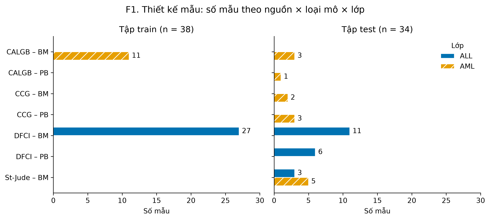
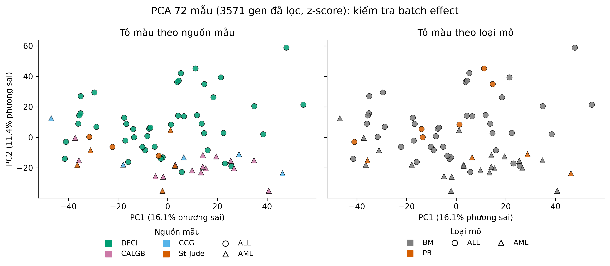

# 1.5. Thiết kế thí nghiệm (Design of Experiment)

Nhóm không tự tiến hành thí nghiệm sinh học, nhưng thiết kế thu thập mẫu của Golub et al. (1999) quyết định
cách diễn giải mọi kết quả phân loại. Mục này phân tích thiết kế mẫu, các yếu tố gây nhiễu và batch effect,
rồi mô tả thiết kế thí nghiệm tính toán của nhóm. Mã và số liệu: `notebooks/02_design_batch.ipynb`.

## 1.5.1. Thiết kế thu thập mẫu của Golub 1999

### Thông tin từ bài báo

Dữ liệu không có cột tuổi bệnh nhân; nhóm tuổi và quy trình phòng lab lấy từ chú thích 13, 15 và 23 của bài báo.

| Đặc điểm | Train (38 mẫu) – chú thích 13 | Test (34 mẫu) – chú thích 23 |
|---|---|---|
| Lớp | 27 ALL, 11 AML | 20 ALL, 14 AML |
| Loại mô | 100% tủy xương (BM) | 24 BM, 10 máu ngoại vi (PB) |
| ALL | trẻ em, DFCI (27) | trẻ em: DFCI (17), St-Jude (3) |
| AML | người lớn, CALGB (11) | người lớn: CALGB (4); trẻ em: St-Jude (5), CCG (5) |
| Quy trình chuẩn bị | Ficoll; RNA tách bằng Trizol hoặc RNAqueous | như train, trừ St-Jude: hypotonic lysis, Qiagen |

Chú thích 15: 80 mẫu được phân tích, 8 mẫu bị loại theo tiêu chí chất lượng định trước. Bài báo ghi nhận
prediction strength trung bình thấp hơn ở mẫu của phòng lab dùng quy trình khác (St-Jude).

### Bảng chéo thiết kế mẫu

Đếm từ `samples.parquet` (khớp hoàn toàn với bài báo):

| split | class | CALGB BM | CALGB PB | CCG BM | CCG PB | DFCI BM | DFCI PB | St-Jude BM |
|---|---|---|---|---|---|---|---|---|
| train | ALL | 0 | 0 | 0 | 0 | 27 | 0 | 0 |
| train | AML | 11 | 0 | 0 | 0 | 0 | 0 | 0 |
| test | ALL | 0 | 0 | 0 | 0 | 11 | 6 | 3 |
| test | AML | 3 | 1 | 2 | 3 | 0 | 0 | 5 |

*Hình F1. Số mẫu theo nguồn × loại mô × lớp. Trong train mỗi lớp chỉ có đúng một thanh.*

### Confounding

- **Train: lớp ≡ tuổi ≡ nguồn.** ALL = trẻ em = DFCI, AML = người lớn = CALGB. Một gen "phân biệt ALL/AML"
  tìm được trên train có thể thực chất phản ánh tuổi hoặc nguồn mẫu; dữ liệu train không tách được ba hiệu ứng
  này. Loại mô không gây nhiễu vì toàn bộ train là BM.
- **Không có ALL người lớn.** Cả 47 mẫu ALL đều là trẻ em, nên kết luận của dự án chỉ áp dụng cho ALL trẻ em.
- **Test phá vỡ một phần confounding.** 10 mẫu AML trẻ em (St-Jude 5, CCG 5) không có tương đương trong train:
  mô hình học nhầm "trẻ em → ALL" sẽ đoán sai đúng nhóm này. St-Jude là nguồn duy nhất có cả ALL (3) và AML (5),
  nên trong St-Jude mô hình chỉ đúng nếu dựa vào tín hiệu bệnh. Test còn có 10 mẫu PB, loại mô không có trong train.

## 1.5.2. Batch effect (giả thuyết H6)

PCA trên 3571 gen đã lọc (log10, chuẩn hóa z-score) của 72 mẫu; PC1–PC3 giải thích 16,1%, 11,4% và 6,0% phương
sai. ALL và AML tách nhau chủ yếu theo PC2; PC1 không tách hai lớp. Trong cùng một lớp, các nguồn và loại mô nằm
lẫn vào nhau.

*Hình F4d. PC1–PC2, màu theo nguồn mẫu (trái) và loại mô (phải); hình dạng theo lớp.*

**Kiểm định gộp 72 mẫu không dùng được.** Kruskal–Wallis theo nguồn cho p = 0,08 (PC1), 7,7·10⁻⁷ (PC2),
9,8·10⁻⁶ (PC3), nhưng theo lớp cũng cho p = 0,3, 5,5·10⁻⁸, 1,1·10⁻⁶. Vì nguồn gần như trùng với lớp, kiểm định
gộp không tách được hiệu ứng nguồn khỏi hiệu ứng bệnh.

**Kiểm định trong từng lớp.** Cố định lớp bệnh rồi so nguồn, loại mô, và St-Jude với phần còn lại (riêng AML)
trên PC1–PC3: 15 kiểm định Kruskal–Wallis, hiệu chỉnh Benjamini–Hochberg
(`results/metrics/batch_effect_tests.csv`).

| Lớp | Yếu tố | Cỡ mẫu | p nhỏ nhất (PC) | p_BH nhỏ nhất |
|---|---|---|---|---|
| ALL | nguồn | DFCI 44 / St-Jude 3 | 0,117 (PC2) | 0,307 |
| ALL | loại mô | BM 41 / PB 6 | 0,0055 (PC3) | 0,083 |
| AML | nguồn | CALGB 15 / CCG 5 / St-Jude 5 | 0,032 (PC3) | 0,161 |
| AML | loại mô | BM 21 / PB 4 | 0,374 (PC1) | 0,623 |
| AML | St-Jude vs còn lại | 5 / 20 | 0,017 (PC3) | 0,131 |

**Kết luận H6.** Không có dấu hiệu batch effect rõ ràng theo nguồn mẫu hay loại mô trên PC1–PC3: không kiểm định
nào có ý nghĩa sau hiệu chỉnh BH. Cấu trúc chính của dữ liệu (PC2, PC3) phản ánh lớp bệnh. Có tín hiệu yếu ở PC3
(ba kiểm định có p gốc < 0,05), trong đó tín hiệu St-Jude ở AML phù hợp với nhận xét của bài báo về quy trình
phòng lab khác. Giới hạn: cỡ mẫu nhỏ (St-Jude ALL 3, CCG 5, PB của AML 4), và cặp DFCI–CALGB không bao giờ so
được trong cùng một lớp, nên batch effect giữa hai nguồn của train, nếu có, không thể loại trừ.

## 1.5.3. Thiết kế thí nghiệm tính toán

Phần phân tích được tổ chức như một thí nghiệm giai thừa; tham số ghi trong `config/experiment_config.yaml`,
code đọc từ file này thay vì ghi cứng.

| Nhân tố | Các mức |
|---|---|
| A. Chọn gen | SNR (Golub), t-test + FDR, LASSO, Elastic Net, RF importance, SVM-RFE |
| B. Số gen k | 5, 10, 20, 50, 100, 200 |
| C. Bộ phân loại | Weighted voting (Golub), DLDA, k-NN, logistic L1, logistic L2, SVM tuyến tính, Random Forest |
| D. Cách đánh giá | Tách 38/34 gốc, LOOCV, nested CV, CV "sai" (chọn gen trước CV) |

A × B × C = 252 cấu hình, so sánh bằng nested CV 5 × 5 lặp 10 lần trên 72 mẫu. Nguyên tắc DoE:

- **Randomization:** 10 seed cố định (0–9), mỗi seed quyết định cách chia fold và `random_state` của mô hình.
- **Replication:** lặp vòng ngoài 10 lần; báo cáo trung bình ± độ lệch chuẩn.
- **Blocking:** chia fold có phân tầng, giữ tỷ lệ ALL/AML trong mọi fold.
- **Control:** so với baseline đoán lớp đa số và với mô hình huấn luyện trên nhãn hoán vị.

`tests/test_experiment_config.py` kiểm tra 252 cấu hình, không có mức trùng lặp, và `outer_repeats` bằng số seed
(`evaluate.py` lặp theo `seeds`).

**Hệ quả của 1.5.1–1.5.2 cho giai đoạn 2:**

- Báo cáo riêng kết quả test trên AML trẻ em (n = 10), mẫu St-Jude (n = 8) và mẫu PB (n = 10).
- So sánh prediction strength theo nguồn khi tái lập Golub (2.1).
- So sánh biểu hiện của danh sách gen cuối giữa AML trẻ em và AML người lớn trong test, để đánh dấu gen có thể
  phản ánh tuổi (2.2, 2.5).
- Không thêm bước hiệu chỉnh batch vào pipeline, vì H6 không thấy batch effect rõ ràng.
