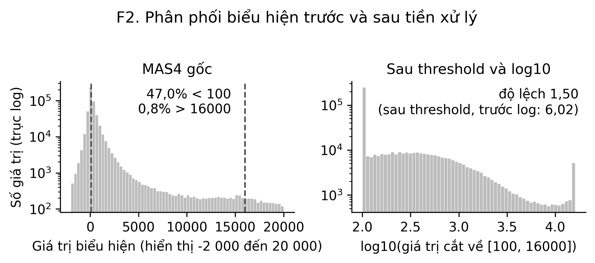
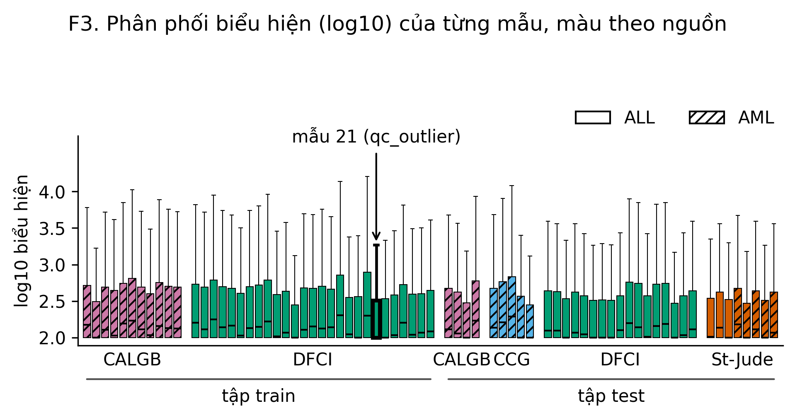
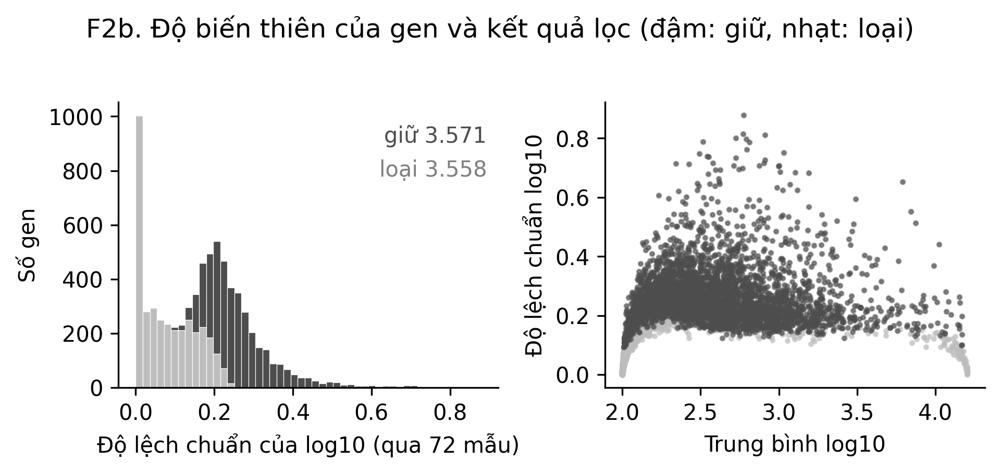
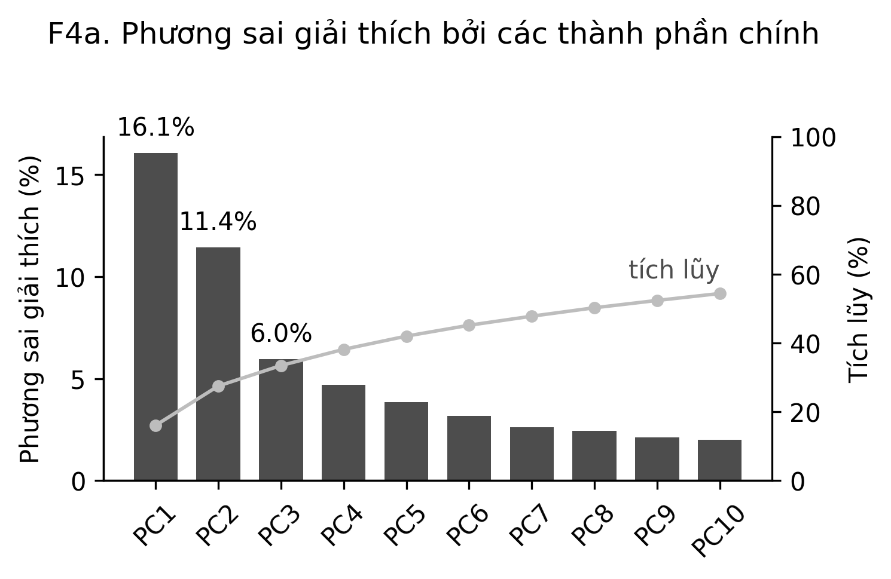
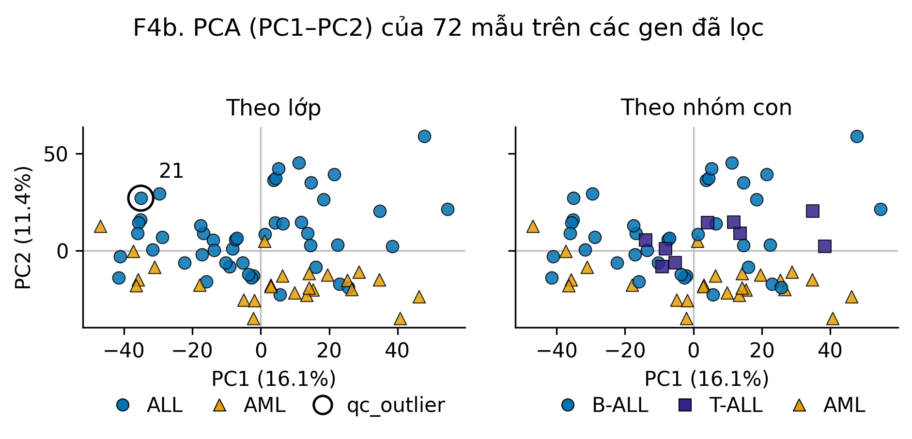
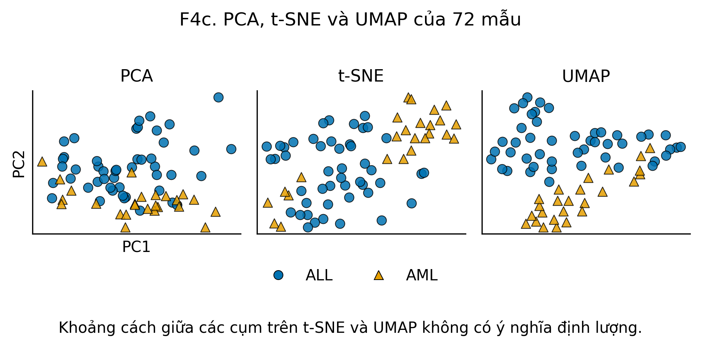
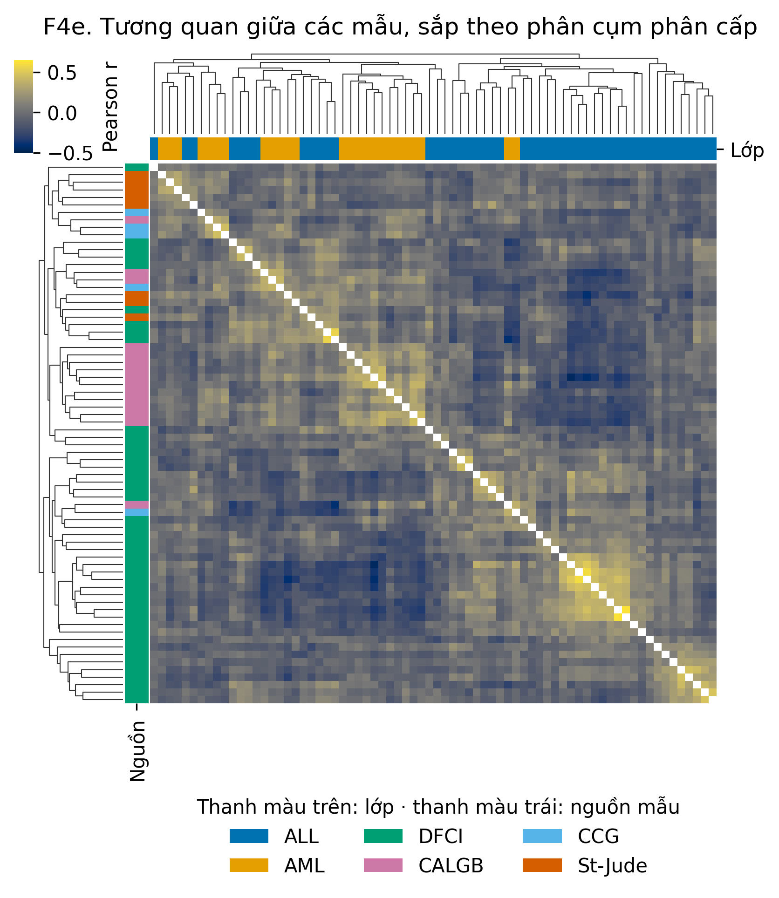

# 3.1. Phân tích khám phá (EDA) và giảm chiều

Mục này khám phá cấu trúc của ma trận 72 mẫu × 7129 probe trước khi xây mô hình: thang đo và phân phối giá trị, chất lượng từng mẫu,
độ biến thiên của gen và cấu trúc đa biến. Mã và số liệu: `notebooks/01_eda.ipynb`, `src/viz.py`, `results/metrics/eda_summary.json`.
Phong cách hình: `docs/style_guide.md`. Thiết kế mẫu và batch effect theo nguồn/loại mô (F1, F4d) nằm ở mục 1.5 (TV1) nên không lặp lại ở đây.

## 3.1.1. Phân tích đơn biến và theo mẫu

### Tỷ lệ lớp
Toàn bộ: 47 ALL và 25 AML (65% / 35%); train 27/11, test 20/14 (khớp Bảng 2.4). Lớp mất cân bằng nên chỉ số chính của dự án là balanced accuracy.

### Thang đo và phép log10 (F2)

47,0% giá trị MAS4 nhỏ hơn 100 (trong đó 28,7% là số âm; nhỏ nhất −28 400) và 0,8% lớn hơn 16 000. Vì vậy không thể lấy log trực tiếp và threshold
[100, 16 000] là cần thiết. Độ lệch (skewness) gộp mọi ô giảm từ 6,02 (sau threshold, trước log) xuống 1,50 sau log10; trung vị theo gen giảm từ 2,03 xuống 0,75
(kurtosis dư trung vị theo gen: 4,89 → 0,80). Log10 giảm mạnh độ lệch phải nhưng không đưa dữ liệu về phân phối chuẩn: còn một cột rất cao ở sàn log10 = 2
(các giá trị bị cắt về 100) và một cột nhỏ ở trần 4,2.

### Chất lượng từng mẫu (F3)

Boxplot log10 của 72 mẫu, sắp theo (tập, nguồn, lớp), màu theo nguồn, gạch chéo là AML. Hộp của các mẫu nhìn chung tương tự nhau; 16/72 mẫu có trung vị đúng bằng mức sàn 2,0.
Mẫu 21 (cờ `qc_outlier` của TV2) có trung vị 2,0 như 15 mẫu kia, IQR thuộc nhóm thấp (thấp thứ 9/72) nhưng không khác hẳn các mẫu còn lại, và tiêu chí modified z (ngưỡng 3,5)
của trung vị biểu hiện không gắn cờ mẫu nào. Cờ của TV2 dựa trên tương quan giữa các mẫu (ADR-004: tương quan trung vị 0,756, z = −4,7) nên boxplot không đủ để loại mẫu; mẫu 21 được giữ nguyên.
Theo nguồn, trung vị của trung vị mẫu là 2,04 ở St-Jude so với 2,10–2,13 ở CALGB, CCG, DFCI; IQR trung vị 0,58 so với 0,64–0,69. St-Jude thấp hơn nhẹ, phù hợp với quy trình lab khác
(chú thích 23 của bài báo), nhưng chỉ có 8 mẫu nên chỉ dùng để mô tả.

### Độ biến thiên của gen và bộ lọc (F2b)

Bộ lọc Dudoit (max/min > 5 và max − min > 500) giữ 3 571 trong 7 129 probe (50,1%) và loại 3 558 probe, khớp kế hoạch. SD log10 trung vị của gen bị loại là 0,068, của gen được giữ là 0,244.
Gen bị loại dồn ở SD thấp, tập trung ở hai đầu mức biểu hiện (sát sàn 2,0 và sát trần 4,2), tức gần như không đổi giữa các mẫu. Bản lọc trên 72 mẫu chỉ dùng cho khám phá
(không dùng nhãn); mô hình lọc trong Pipeline trên từng fold huấn luyện (mục 2.6; lọc trên 38 mẫu train còn 3 052 gen).

## 3.1.2. Phân tích đa biến và giảm chiều

PCA trên `X_log10_filtered` (3 571 gen), mỗi gen được chuẩn hóa z-score.

### Phương sai giải thích (F4a)

PC1 giải thích 16,1%, PC2 11,4%, PC3 6,0%, PC4 4,7%, PC5 3,8%. PC1–PC2 cộng 27,5% và PC1–PC3 cộng 33,5%; cần 8 PC để đạt 50% và 34 PC để đạt 80% phương sai.
Phương sai trải trên nhiều chiều nên hai PC đầu chỉ mô tả một phần dữ liệu. Con số PC1–PC3 khớp với kết quả của TV1 ở mục 1.5.

### Cấu trúc lớp trên PC1–PC2 (F4b)

Quy ước mô tả của nhóm: một PC "tách tốt" ALL/AML nếu AUC (Mann–Whitney, điểm PC theo lớp) ≥ 0,9; "một phần" nếu 0,7 ≤ AUC < 0,9; "không" nếu < 0,7.

| PC | PC1 | PC2 | PC3 | PC4 | PC5 |
|---|---|---|---|---|---|
| AUC | 0,58 | 0,89 | 0,85 | 0,63 | 0,55 |
| Đánh giá | không | một phần | một phần | không | không |

PC1 không tách hai lớp. PC2 và PC3 tách một phần (PC2: p = 5,7e-08). Trên mặt phẳng PC1–PC2 phần lớn AML nằm ở nửa dưới (PC2 thấp) và ALL ở nửa trên, nhưng hai lớp chồng lấn ở vùng
giữa-trái (silhouette theo lớp = 0,14, thấp). T-ALL không tạo cụm riêng trên PC1–PC2 (silhouette theo nhóm con = −0,02). Mẫu 21 nằm trong đám mây ALL, không tách xa các mẫu khác.
Phần tô theo nguồn mẫu và loại mô (batch effect, H6) xem F4d ở mục 1.5.

### So sánh PCA, t-SNE và UMAP (F4c)

Cùng đầu vào, cùng seed (`RANDOM_SEED`); t-SNE `perplexity` 15, UMAP `n_neighbors` 10. Khoảng cách giữa các cụm trên t-SNE và UMAP không có ý nghĩa định lượng.
Cả ba phương pháp cho cùng bức tranh: AML tập trung thành một vùng riêng nhưng chưa tách hẳn khỏi ALL (vài AML lẫn trong ALL). UMAP cho vùng AML gọn nhất, PCA lẫn nhiều nhất.
Hình dạng cụm phụ thuộc seed và tham số, nên chỉ kết luận định tính.

### Tương quan giữa các mẫu (F4e)

Tương quan Pearson giữa 72 mẫu (gen đã z-score), phân cụm phân cấp theo khoảng cách 1 − r, liên kết average. Cắt cây ở k = 2: nhánh 1 có 38 mẫu (23 AML, 15 ALL),
nhánh 2 có 34 mẫu (32 ALL, 2 AML); ARI so với lớp = 0,27 (mô tả; phân cụm có hệ thống là việc 1.5 của TV5). Cả 9 T-ALL nằm ở nhánh 2.
Cả 8 mẫu St-Jude (3 ALL, 5 AML) nằm ở nhánh 1. Mẫu 21 không nổi bật: tương quan trung vị với các mẫu khác là −0,02 (hạng 52/72); thấp nhất là mẫu 69 (−0,08).

## 3.1.3. Kết luận và ý nghĩa cho giai đoạn 2

- Threshold [100, 16 000] và log10 là cần thiết (47% giá trị dưới 100, có số âm); log10 giảm độ lệch nhưng còn cột lớn ở sàn.
- Cấu trúc ALL/AML có trong dữ liệu nhưng không nằm ở PC1: PC2 và PC3 tách một phần (AUC 0,89 và 0,85), nên việc chọn biến có giám sát (mục 3.3) là cần thiết, không thể chỉ dựa vào PC đầu (liên hệ H2, H5).
- Mẫu 21 (`qc_outlier`) không khác rõ rệt trên boxplot, PCA và ma trận tương quan; giữ nguyên (ADR-004) và theo dõi khi phân tích lỗi (TV5, mục 2.5).
- Cả 8 mẫu St-Jude cùng nằm một nhánh phân cụm, và St-Jude có IQR trung vị thấp hơn nhẹ. Đây là dấu hiệu cần theo dõi (quy trình lab khác), không phải kết luận: TV1 không thấy khác biệt có ý nghĩa trên PC1–PC3 trong từng lớp (H6).
- Hạn chế: mọi phân tích ở mục này chạy trên gen đã lọc theo cả 72 mẫu và dùng nhãn chỉ để tô màu hoặc mô tả; kết quả mô tả, không dùng để đánh giá hiệu năng mô hình.
