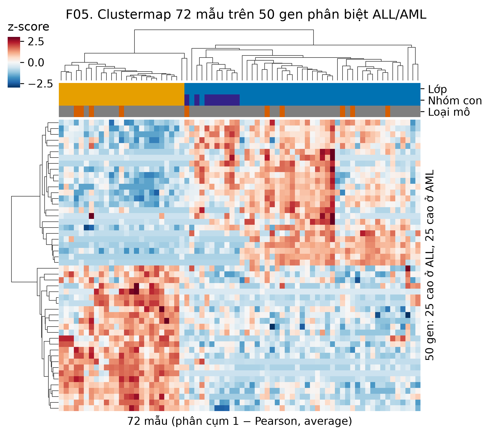
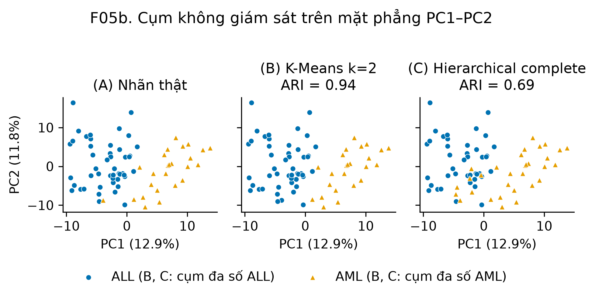
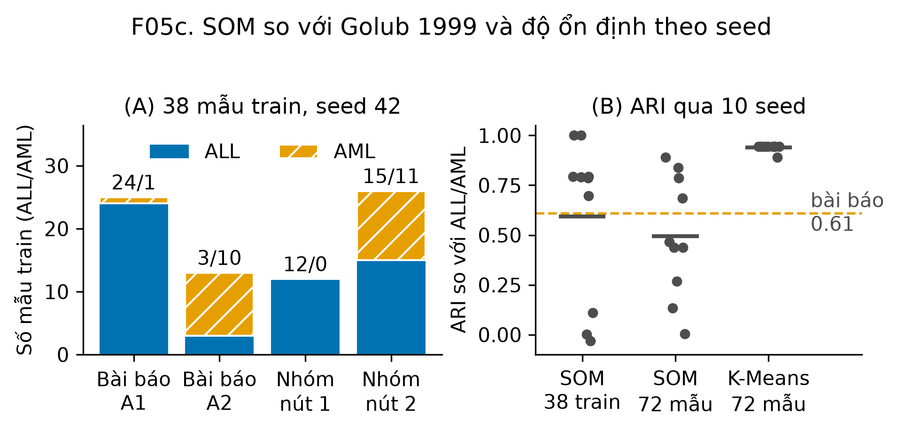

# 3.2. Khám phá lớp không giám sát (Class Discovery - Giả thuyết H5)

Phụ trách: **Thành viên 5 (TV5)** · Giai đoạn 1 · Sửa số liệu 01/11 (TV1, ADR-012)  
Mã công việc: **1.5** · Mã và số liệu: `notebooks/03_discovery.ipynb` (sinh ra `results/metrics/cluster_discovery_metrics.csv` và hình F05, F05b, F05c)

---

## 3.2.1. Đặt vấn đề và Mục tiêu nghiên cứu

Một trong những đóng góp mang tính bước ngoặt của Golub et al. (Science, 1999) là chứng minh rằng các phân loại ung thư học không nhất thiết phải dựa trên kiến thức lâm sàng có sẵn; dữ liệu biểu hiện gen microarray tự thân có thể phản ánh các cụm sinh học tự nhiên tương ứng với các bệnh lý khác nhau.

Mục này giải quyết bài toán con **Class Discovery** và kiểm chứng giả thuyết nghiên cứu **H5**:
> **Giả thuyết H5:** *Dữ liệu biểu hiện gen có cấu trúc cụm tự nhiên trùng khớp với phân loại ALL/AML và các phân nhóm subtype (B-ALL, T-ALL) mà không cần sử dụng nhãn chẩn đoán lâm sàng.*

### Dữ liệu đầu vào:
Toàn bộ phân tích được thực hiện trên tập dữ liệu tầng `curated` gồm $n = 72$ mẫu bệnh nhân và $p = 3571$ gen (`X_log10_filtered.parquet`) đã qua tiền xử lý cắt ngưỡng $[100, 16000]$, chuyển đổi $\log_{10}$ và lọc các gen biến động thấp theo tiêu chí Dudoit et al. (2002) bởi TV3. Bộ lọc này không dùng nhãn. Nhãn lâm sàng (`class`, `subtype`) chỉ được dùng ở bước đánh giá để tính **Adjusted Rand Index (ARI)**.

Mọi bảng chéo dưới đây gắn nhãn cụm theo `sample_id`. Bản trước (31/10) tạo bảng chéo từ `pd.Series(labels)` không có index nên nhãn cụm bị lệch một mẫu so với `samples` (index 1–72); các bảng chéo và tỷ lệ "42/47, 20/25", "23/27, 10/11" của bản đó là sai. Các giá trị ARI và silhouette tính trên mảng nên không bị ảnh hưởng.

---

## 3.2.2. Phân cụm K-Means và Độ ổn định (Stability)

K-Means được chạy với 10 seed (`random_state` 0–9, $n_{\text{init}} = 10$); bảng chéo dùng seed 42 của dự án.

### Kết quả với $k = 2$ (ALL vs AML):
- **ARI:** $0.9386 \pm 0.0163$ qua 10 seed.
- **Silhouette:** $0.0954 \pm 0.0005$.
- **Bảng chéo (seed 42):**

| Cụm K-Means | ALL | AML |
|---|:---:|:---:|
| Cụm AML | 0 | 24 |
| Cụm ALL | 47 | 1 |

Chỉ **1/72** mẫu nằm sai cụm: mẫu 66 (AML, tập test, nguồn CCG, tủy xương). Toàn bộ 47 ALL nằm chung một cụm.

### Kết quả với $k = 4$ (AML, B-ALL, T-ALL):
- **ARI so với subtype:** $0.4260 \pm 0.1074$; **Silhouette:** $0.0776 \pm 0.0045$.
- Bảng chéo (seed 42): một cụm gần như thuần AML (24 AML); ba cụm còn lại chia nhỏ ALL thành {22 B-ALL, 1 T-ALL, 1 AML}, {6 B-ALL, 6 T-ALL}, {10 B-ALL, 2 T-ALL}. **T-ALL không tạo cụm riêng**: 9 T-ALL rải trên cả ba cụm ALL.

---

## 3.2.3. Phân cụm phân cấp (Hierarchical Clustering) và mẫu 21

Khoảng cách giữa hai mẫu là $d(u, v) = 1 - r(u, v)$ (tương quan Pearson). Kế hoạch yêu cầu liên kết **average**; nhóm đối chiếu thêm **complete** (và single, ward trong bảng khảo sát của notebook).

| Liên kết | $k$ | ARI vs Class | ARI vs Subtype | Silhouette | Cỡ cụm |
|---|:---:|:---:|:---:|:---:|---|
| **Average** | 2 | −0.0129 | – | 0.2822 | 71 / 1 |
| **Average** | 4 | – | 0.3845 | 0.1296 | 49 / 21 / 1 / 1 |
| **Complete** | 2 | 0.6900 | – | 0.1483 | 31 / 41 |
| **Complete** | 4 | – | 0.4040 | 0.1054 | 22 / 40 / 9 / 1 |
| Ward (Euclid) | 2 | 0.6889 | – | 0.0778 | – |

- **Average, $k = 2$:** cây chỉ tách riêng **mẫu 21** thành một cụm 1 mẫu; 71 mẫu còn lại chung một cụm. Mẫu 21 là mẫu duy nhất TV2 gắn cờ `qc_outlier` ở công việc 1.1 (modified z-score −4.7 của tương quan trung vị với các mẫu khác). Single linkage cho đúng kết quả này. Silhouette 0.28 cao nhất bảng nhưng không có ý nghĩa vì một cụm chỉ có 1 mẫu.
- **Complete, $k = 2$:** hai cụm cân bằng; cụm ALL gồm 41 ALL thuần, cụm còn lại gồm cả 25 AML và 6 ALL (ARI 0.690).
- **$k = 4$:** complete đưa cả 9 T-ALL vào chung cụm với 31 B-ALL, nên cũng không tách được T-ALL.

Kết quả với phương pháp mà kế hoạch chỉ định (average) vì vậy là âm tính; kết quả dương tính phụ thuộc vào việc đổi sang complete. Lý do đổi được ghi ở ADR-012.

---

## 3.2.4. SOM so với Golub 1999

### Bài báo
SOM hai cụm trên 38 mẫu train (27 ALL, 11 AML) dùng 6817 gen cho: *"Class A1 contained mostly ALL (24 of 25 samples) and class A2 contained mostly AML (10 of 13 samples)"*. Tức là A1 = 24 ALL + 1 AML, A2 = 10 AML + 3 ALL: **34/38 mẫu nằm ở cụm đa số đúng lớp**, tương ứng ARI ≈ 0.61. Bản trước của mục này đọc nhầm thành "24/25 mẫu ALL" và "10/13 mẫu AML" (như thể có 25 ALL và 13 AML).

### Nhóm tái lập
`minisom` lưới $1 \times 2$, σ = 0.5, learning rate 0.5, khởi tạo trọng số ngẫu nhiên từ mẫu; 1000 vòng trên 38 mẫu train, 1500 vòng trên 72 mẫu; 3571 gen đã lọc.

| Dữ liệu | ARI (10 seed) | Số mẫu đúng cụm đa số | Seed 42 |
|---|:---:|:---:|---|
| 38 mẫu train | $0.594 \pm 0.384$ | 27–38 / 38 | {15 ALL, 11 AML} và {12 ALL, 0 AML} → 27/38 |
| 72 mẫu | $0.495 \pm 0.287$ | 47–70 / 72 | {46 ALL, 1 AML} và {1 ALL, 24 AML} → 70/72 |
| 72 mẫu, lưới $2 \times 2$ (vs subtype) | $0.372 \pm 0.094$ | – | – |

- 7/10 seed trên train đạt hoặc vượt mức bài báo (2 seed tách đúng 38/38); 3/10 seed gần như ngẫu nhiên (ARI ≈ 0). SOM ở cấu hình này **không ổn định**, nên không dùng làm bằng chứng chính cho H5.
- Bản trước ghi SOM trên 72 mẫu đạt ARI 0.944. Đó là kết quả của riêng seed 42 (70/72), không đại diện cho 10 seed.
- Nhóm không dò lại σ, learning rate hay cách chuẩn hóa để SOM "đẹp" hơn: dò tham số theo ARI là dùng nhãn để chọn mô hình, trái với mục đích của phân cụm không giám sát.

---

## 3.2.5. Trực quan hóa kết quả

### 1. Hình F05: Clustermap trên 50 gen phân biệt

*Hình F05. Clustermap 72 mẫu × 50 gen (25 gen SNR cao nhất ở ALL và 25 ở AML, theo `gene_ranking.csv` của TV4), z-score theo gen, phân cụm 1 − Pearson, average. Thanh màu: lớp (ALL xanh dương, AML cam), nhóm con (T-ALL tím đậm), loại mô (PB cam đậm, BM xám).*

- Nhánh mẫu cấp cao nhất tách thành {25 AML, 1 ALL} và {46 ALL}; các mẫu PB nằm lẫn trong cả hai nhánh, không tạo nhánh riêng.
- **Lưu ý:** 50 gen này được chọn bằng nhãn (SNR trên 38 mẫu train), nên F05 chỉ minh họa; nó không phải bằng chứng không giám sát cho H5. Bằng chứng là các ARI tính trên 3571 gen ở mục 3.2.2–3.2.4.

### 2. Hình F05b: Cụm trên mặt phẳng PC1–PC2

*Hình F05b. PCA trên 3571 gen (không chuẩn hóa từng gen; PC1 12.9%, PC2 11.8% phương sai). (A) Nhãn thật; (B) K-Means $k = 2$, seed 42 (ARI 0.94); (C) Hierarchical complete $k = 2$ (ARI 0.69). Ở (B) và (C) màu là lớp chiếm đa số của cụm.*

K-Means (B) gần như trùng với nhãn thật (A); complete (C) gán nhầm 6 ALL nằm gần vùng AML ở góc dưới giữa.

### 3. Hình F05c: SOM so với bài báo và độ ổn định

*Hình F05c. (A) Thành phần hai cụm SOM trên 38 mẫu train: bài báo (A1, A2) và nhóm (seed 42). (B) ARI qua 10 seed của SOM trên train, SOM trên 72 mẫu và K-Means $k = 2$ trên 72 mẫu; vạch ngang là trung bình, đường đứt là mức của bài báo (0.61).*

---

## 3.2.6. Bảng tổng hợp chỉ số định lượng (Nghiệm thu)

Lấy từ `results/metrics/cluster_discovery_metrics.csv`; "a ± b" là trung bình ± độ lệch chuẩn qua 10 seed.

| Thuật toán | $k$ | Dữ liệu | ARI vs Class | ARI vs Subtype | Silhouette |
|---|:---:|---|:---:|:---:|:---:|
| K-Means | 2 | 72 mẫu | **0.9386 ± 0.0163** | – | 0.0954 ± 0.0005 |
| K-Means | 4 | 72 mẫu | – | 0.4260 ± 0.1074 | 0.0776 ± 0.0045 |
| Hierarchical (1−r, average) | 2 | 72 mẫu | −0.0129 | – | 0.2822 |
| Hierarchical (1−r, average) | 4 | 72 mẫu | – | 0.3845 | 0.1296 |
| Hierarchical (1−r, complete) | 2 | 72 mẫu | 0.6900 | – | 0.1483 |
| Hierarchical (1−r, complete) | 4 | 72 mẫu | – | 0.4040 | 0.1054 |
| SOM $1 \times 2$ | 2 | 38 train | 0.5939 ± 0.3835 | – | – |
| SOM $1 \times 2$ | 2 | 72 mẫu | 0.4947 ± 0.2870 | – | – |
| SOM $2 \times 2$ | 4 | 72 mẫu | – | 0.3720 ± 0.0940 | – |

---

## 3.2.7. Diễn giải Sinh học và Kết luận Giả thuyết H5

### Diễn giải sinh học:
Tại sao các thuật toán không giám sát lại có thể tự động tách được ALL và AML?
- Về mặt huyết học, ALL bắt nguồn từ dòng lympho (lymphoid lineage) còn AML bắt nguồn từ dòng tủy (myeloid lineage). Đây là hai nhánh biệt hóa tách rời nhau từ rất sớm trong quá trình tạo máu từ tế bào gốc vạn năng (pluripotent hematopoietic stem cell).
- Sự phân hóa dòng dẫn đến hàng trăm gen điều hòa phiên mã cốt lõi (*transcription factors*) và các thụ thể biệt hóa (*differentiation clusters*) biểu hiện đối nghịch: tế bào ALL biểu hiện mạnh *CD19*, *c-myb*, *TCF3*, *PAX5*, trong khi tế bào AML biểu hiện các enzyme hạt và thụ thể bám dính như *Myeloperoxidase (MPO)*, *Cathepsin D*, *CST3*, *CD33*.
- B-ALL và T-ALL cùng thuộc dòng lympho nên khác biệt giữa chúng nhỏ hơn nhiều so với ALL/AML; với chỉ 9 T-ALL, tín hiệu này bị lấn át khi phân cụm trên 3571 gen.

### Kết luận chính thức:
> **KẾT LUẬN VỀ H5: ỦNG HỘ Ở MỨC ALL/AML, KHÔNG ỦNG HỘ Ở MỨC B-ALL/T-ALL.**
> - **ALL/AML:** K-Means $k = 2$ tách gần hoàn hảo (ARI 0.94 ± 0.02, sai 1/72 mẫu) mà không dùng nhãn. Kết quả phụ thuộc phương pháp: hierarchical average (phương pháp kế hoạch chỉ định) thất bại vì mẫu ngoại lai 21; complete đạt ARI 0.69.
> - **So với Golub 1999:** SOM của nhóm đạt mức của bài báo (34/38, ARI ≈ 0.61) ở 7/10 seed nhưng không ổn định (ARI 0.59 ± 0.38), nên chỉ tái lập được một phần.
> - **B-ALL/T-ALL:** không phương pháp nào tách T-ALL thành cụm riêng (ARI vs subtype 0.37–0.43).
> - Silhouette của mọi phương án đều thấp (≤ 0.15 nếu bỏ trường hợp cụm 1 mẫu): cấu trúc ALL/AML có thật nhưng hai cụm không tách xa nhau.
