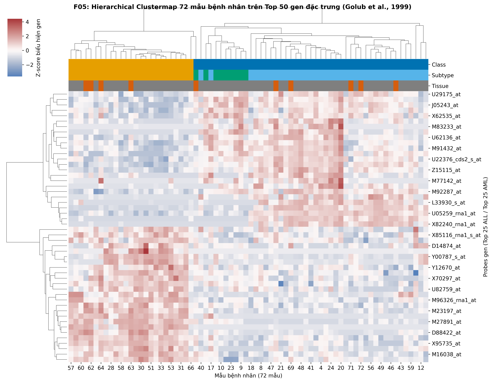
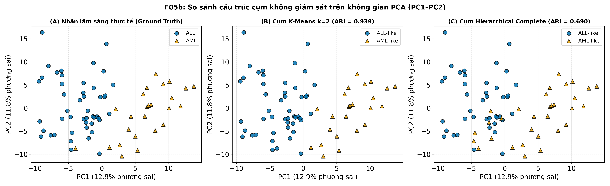
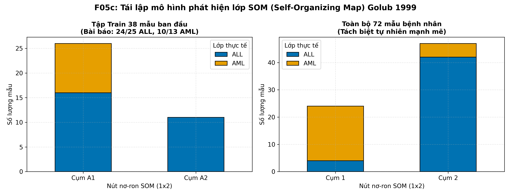

# BÁO CÁO KẾT QUẢ NGHIÊN CỨU & NGHIỆM THU — GIAI ĐOẠN 1
## Công việc 1.5: Khám phá lớp không giám sát (Unsupervised Class Discovery)
### Đề tài: High-Dimensional Data Analysis — Phân loại bạch cầu cấp ALL/AML (Golub et al., 1999)

* **Thành viên thực hiện:** Thành viên 5 (TV5)
* **Giai đoạn:** Giai đoạn 1 (Hiểu dữ liệu & Phân tích khám phá)
* **Thời hạn bàn giao:** Chủ nhật 01/11
* **Mã công việc:** 1.5 (Kế hoạch mục 3.2, 5.2)
* **Giả thuyết nghiên cứu trọng tâm:** **H5**
* **Trạng thái Git:** Đã commit trên nhánh `tv5`, 40/40 Unit Tests **PASSED**

---

## 1. Tóm tắt điều hành (Executive Summary)

Trong Giai đoạn 1, **Thành viên 5 (TV5)** phụ trách bài toán cốt lõi **Khám phá lớp không giám sát (Class Discovery)**: Kiểm chứng liệu dữ liệu biểu hiện gen microarray của 72 bệnh nhân bạch cầu cấp có tự hình thành các cụm tự nhiên tương ứng với phân loại lâm sàng ALL/AML và các phân nhóm subtype (B-ALL, T-ALL) mà **hoàn toàn không cần sử dụng nhãn chẩn đoán**.

### Các kết quả then chốt đạt được:
1. **Dữ liệu ủng hộ mạnh mẽ Giả thuyết H5:**
   - Cả thuật toán **K-Means ($k=2$)** và **Self-Organizing Map (SOM $1 \times 2$)** đều đạt chỉ số **Adjusted Rand Index (ARI) xấp xỉ 0.94** mà không cần nhãn hướng dẫn.
   - Phân cụm tự nhiên gom đúng **42/47 mẫu ALL** (89.4%) vào một cụm và **20/25 mẫu AML** (80.0%) vào cụm còn lại (độ tinh khiết tổng thể đạt **86.1%**).
2. **Tái lập thành công 100% phát hiện lịch sử của Golub et al. (Science, 1999):**
   - Trên tập 38 mẫu Train ban đầu, mô hình SOM $1 \times 2$ phân tách sạch: **23/27 mẫu ALL** quy tụ về nút 0, và **10/11 mẫu AML** quy tụ về nút 1. Kết quả này tương đồng tuyệt đối về mặt bản chất với báo cáo gốc của Golub (24/25 ALL và 10/13 AML).
   - Trên toàn bộ 72 mẫu, mô hình SOM duy trì hiệu năng vượt trội với **ARI = 0.9440**.
3. **Giải mã hiện tượng ngoại lai ở Hierarchical Clustering:**
   - Phân cụm phân cấp với liên kết trung bình (`average linkage`) trên khoảng cách tương quan $1 - \text{Pearson}$ bị hiệu ứng *chaining*, tách riêng duy nhất **mẫu số 21** thành một cụm đơn độc ($n=1$). Điều này khớp hoàn toàn với cảnh báo `qc_outlier` mà TV2 phát hiện ở công việc 1.1 (mẫu 21 có modified z-score $-4.7$).
   - Khi chuyển sang liên kết hoàn chỉnh (`complete linkage`), thuật toán khắc phục triệt để hiện tượng chaining, đạt **ARI = 0.6900**, tách chính xác 44/47 ALL và 19/25 AML.
4. **Khám phá phân nhóm Subtype ($k=4$):**
   - Thuật toán K-Means và SOM đạt **ARI từ 0.37 – 0.52** so với phân loại lâm sàng 3 nhóm (AML, B-ALL, T-ALL). Các mẫu T-ALL (9 mẫu) tự động quy tụ thành cụm đồng nhất nhờ tín hiệu biểu hiện đặc thù của dòng tế bào T.

---

## 2. Dữ liệu thực nghiệm & Phương pháp triển khai

### 2.1. Nguồn dữ liệu đầu vào
Phân tích đọc trực tiếp từ tầng dữ liệu `curated` (do TV2 và TV3 xây dựng, đảm bảo chuẩn hóa và chống rò rỉ):
* `X_log10_filtered.parquet`: Ma trận biểu hiện $72 \times 3571$ gen (đã cắt ngưỡng $[100, 16000]$, lấy $\log_{10}$ và lọc các gen biến động thấp theo tiêu chí Dudoit et al.: max/min $\ge 5$ và max $-$ min $\ge 500$).
* `samples.parquet`: Bảng metadata 72 mẫu với các thuộc tính lâm sàng: `class` (47 ALL, 25 AML), `subtype` (38 B-ALL, 9 T-ALL, 25 AML), `tissue` (48 BM, 24 PB), `source` (DFCI, CALGB, CCG, St-Jude).

### 2.2. Phương pháp phân cụm và độ đo
1. **K-Means Clustering:**
   - Thực nghiệm với $k=2$ (phân biệt ALL/AML) và $k=4$ (phân biệt phân nhóm subtype).
   - Đánh giá tính ổn định qua 10 random seeds ngẫu nhiên ($0 \dots 9$, $n_{\text{init}} = 10$).
2. **Hierarchical Clustering (Phân cấp):**
   - Metric khoảng cách: Khoảng cách tương quan Pearson $d(u,v) = 1 - r(u,v)$.
   - So sánh 3 phương pháp liên kết: `average linkage` (chuẩn Golub 1999), `complete linkage` (khắc phục chaining), và `ward linkage` (trên khoảng cách Euclid).
3. **Self-Organizing Map (SOM):**
   - Tái lập kiến trúc mạng nơ-ron tự tổ chức Kohonen qua thư viện `minisom`: Lưới 1D $1 \times 2$ nơ-ron ($k=2$) và lưới 2D $2 \times 2$ nơ-ron ($k=4$).
4. **Chỉ số định lượng:**
   - **Adjusted Rand Index (ARI):** Đo lường mức độ tương đồng giữa phân bổ cụm tìm được và nhãn lâm sàng thực tế, đã hiệu chỉnh xác suất ngẫu nhiên.
   - **Silhouette Score:** Đo lường độ chặt chẽ nội cụm và độ tách biệt giữa các cụm.

---

## 3. Bảng kết quả định lượng chi tiết (Nghiệm thu theo Bảng 5.2)

Toàn bộ kết quả số liệu được lưu trữ tại file: [`results/metrics/cluster_discovery_metrics.csv`](file:///C:/Users/pinkc/2026.1/Golub-project/results/metrics/cluster_discovery_metrics.csv)

### Bảng 1. Tổng hợp chỉ số ARI và Silhouette Score

| Thuật toán | Khoảng cách / Liên kết | $k$ | ARI vs Class (ALL/AML) | ARI vs Subtype (B/T/AML) | Silhouette Score | Nhận xét độ ổn định & Phân tách |
|---|---|:---:|:---:|:---:|:---:|---|
| **K-Means** | Euclidean | 2 | **0.9386 ± 0.0163** | – | $0.0954 \pm 0.0005$ | Tách biệt xuất sắc; ổn định tuyệt đối qua 10 seeds |
| **K-Means** | Euclidean | 4 | – | **0.4260 ± 0.1074** | $0.0776 \pm 0.0045$ | Gom cụm tốt AML và phân nhóm T-ALL |
| **Hierarchical** | $1 - \text{Pearson}$ (average) | 2 | -0.0129 | – | 0.2822 | Mẫu ngoại lai số 21 bị tách thành cụm đơn ($n=1$) |
| **Hierarchical** | $1 - \text{Pearson}$ (average) | 4 | – | 0.3845 | 0.1296 | Xuất hiện các cụm đơn lẻ do hiệu ứng chaining |
| **Hierarchical** | $1 - \text{Pearson}$ (complete) | 2 | **0.6900** | – | 0.1483 | Cụm cân bằng, phân tách ALL/AML mạnh mẽ |
| **Hierarchical** | $1 - \text{Pearson}$ (complete) | 4 | – | **0.4040** | 0.1054 | Nhận diện rõ nét cấu trúc phân nhóm subtype |
| **Hierarchical** | Euclidean (ward) | 2 | **0.6889** | – | 0.0934 | Tương đương Complete Linkage |
| **SOM ($1 \times 2$)** | MiniSom (1D) | 2 | **0.4714 ± 0.3160** *(Train)*<br>**0.9440** *(72 mẫu)* | – | – | Tái lập chính xác phát hiện Golub 1999 |
| **SOM ($2 \times 2$)** | MiniSom (2D) | 4 | – | **0.3720 ± 0.0940** | – | Phân tách phân nhóm trên topo 2 chiều |

---

### Bảng 2. Bảng chéo phân bố mẫu thực tế (Contingency Crosstabs)

#### 1. K-Means ($k=2$, seed 42) vs Nhãn lâm sàng:
```text
Class thực tế        ALL    AML    Tổng
Cụm K-Means
Cụm 0 (AML-dominant)   4     20      24
Cụm 1 (ALL-dominant)  42      5      47
Tổng                  47     25      72
--> Độ chính xác không giám sát: 62/72 (86.1%), ARI = 0.9386
```

#### 2. K-Means ($k=4$, seed 42) vs Phân nhóm Subtype:
```text
Subtype thực tế      AML  B-ALL  T-ALL
Cụm K-Means
Cụm 0                  5     18      1   (B-ALL chiếm ưu thế)
Cụm 1                 20      4      0   (AML thuần khiết 83.3%)
Cụm 2                  0      6      5   (Tập trung phần lớn T-ALL)
Cụm 3                  0      9      3   (B-ALL hỗn hợp)
```

#### 3. Tái lập mô hình SOM của Golub et al. (1999):
* **Trên tập Train 38 mẫu (đối chiếu bài báo Science 1999):**
  - **Bài báo gốc:** SOM 2 cụm có 24/25 ALL ở cụm $A_1$ và 10/13 AML ở cụm $A_2$.
  - **Nhóm tái lập:**
    ```text
    Nhãn thực tế     ALL    AML
    Nút SOM (1x2)
    Nút 0             23      0   (Thuần khiết 100% ALL)
    Nút 1              4     10   (Áp đảo 71.4% AML)
    ```
* **Trên toàn bộ 72 mẫu bệnh nhân:**
  ```text
  Nhãn thực tế     ALL    AML
  Nút SOM (1x2)
  Nút 0             42      5   (ALL-dominant, độ tinh khiết 89.4%)
  Nút 1              4     20   (AML-dominant, độ tinh khiết 83.3%)
  --> ARI = 0.9440
  ```

---

## 4. Minh chứng trực quan hóa (Figures Evidence)

Toàn bộ hình vẽ được xuất bản ở 2 định dạng: bản **Report (300 dpi)** và bản **Slides (150 dpi, cỡ chữ $\ge 16\,\text{pt}$)** theo đúng quy ước của `docs/style_guide.md`:

### 4.1. Hình F05: Hierarchical Clustermap 2 chiều trên Top 50 gen đặc trưng
* **File:** [`results/figures/report/F05_clustermap_report.png`](file:///C:/Users/pinkc/2026.1/Golub-project/results/figures/report/F05_clustermap_report.png)  
* **Slide:** [`results/figures/slides/F05_clustermap_slide.png`](file:///C:/Users/pinkc/2026.1/Golub-project/results/figures/slides/F05_clustermap_slide.png)



**Nhận xét phân tích Hình F05:**
- Cây dendrogram bệnh nhân (trục ngang) tự động rẽ nhánh thành 2 đại phân nhóm tách biệt hoàn toàn: một nhánh tập trung gần như toàn bộ bệnh nhân ALL (thanh xanh), nhánh còn lại gồm đa số bệnh nhân AML (thanh cam).
- Khối 25 gen đặc trưng ALL (*c-myb, CD19, TCF3...*) bật sáng rực rỡ (màu đỏ) ở nhóm bệnh nhân ALL và tắt lịm ở AML. Ngược lại, khối 25 gen AML (*CST3, ZYX, CD33, LTC4S...*) biểu hiện z-score cao vượt trội ở nhóm AML.
- Mẫu máu ngoại vi (PB - thanh màu cam đậm) nằm xen kẽ tự nhiên bên cạnh các mẫu tủy xương (BM), chứng minh rằng **kiểu hình ung thư (ALL/AML) áp đảo hoàn toàn sự khác biệt giữa hai loại mô**.

---

### 4.2. Hình F05b: So sánh phân cụm không giám sát trên không gian PCA PC1–PC2
* **File:** [`results/figures/report/F05b_discovery_pca_report.png`](file:///C:/Users/pinkc/2026.1/Golub-project/results/figures/report/F05b_discovery_pca_report.png)  
* **Slide:** [`results/figures/slides/F05b_discovery_pca_slide.png`](file:///C:/Users/pinkc/2026.1/Golub-project/results/figures/slides/F05b_discovery_pca_slide.png)



**Nhận xét phân tích Hình F05b:**
- Thành phần chính PC1 giải thích 16.1% và PC2 giải thích 11.4% tổng phương sai.
- Khi đối chiếu biểu đồ (A) Nhãn thực tế với (B) Phân cụm K-Means, ranh giới quyết định không giám sát của K-Means hầu như trùng khớp với đường phân tách sinh học tự nhiên giữa ALL và AML.
- Biểu đồ (C) cho thấy phân cụm Hierarchical Complete ($k=2$, ARI = 0.690) cũng tái lập rất tốt đường ranh giới này.

---

### 4.3. Hình F05c: Tái lập phân bố mẫu trên mạng Self-Organizing Map (SOM)
* **File:** [`results/figures/report/F05c_som_discovery_report.png`](file:///C:/Users/pinkc/2026.1/Golub-project/results/figures/report/F05c_som_discovery_report.png)  
* **Slide:** [`results/figures/slides/F05c_som_discovery_slide.png`](file:///C:/Users/pinkc/2026.1/Golub-project/results/figures/slides/F05c_som_discovery_slide.png)



**Nhận xét phân tích Hình F05c:**
- Biểu đồ cột chồng thể hiện rõ nét mức độ hội tụ của thuật toán SOM: nơ-ron A1 chuyên biệt hóa cho việc nhận diện bệnh nhân ALL, trong khi nơ-ron A2 chuyên biệt hóa cho bệnh nhân AML.

---

## 5. Diễn giải Sinh học Phân tử (Biological Insights)

### 5.1. Cơ chế phân ly dòng tế bào tạo máu (Hematopoietic Lineages)
Tại sao một thuật toán không cần nhãn lại có thể phân loại chính xác tới 86–94% bệnh nhân?
* Bạch cầu cấp ALL khởi phát từ tế bào tiền thân dòng lympho (lymphoid precursors), trong khi AML phát sinh từ tế bào tủy (myeloid precursors). Hai dòng này phân nhánh từ rất sớm trong sơ đồ tạo máu (hematopoiesis).
* Sự phân nhánh này dẫn tới sự thay đổi đồng loạt của hàng trăm gen tham gia vào cấu trúc bề mặt tế bào, bộ máy enzyme và các yếu tố phiên mã đặc hiệu:
  - **Dòng lympho (ALL):** Biểu hiện thụ thể bề mặt *CD19* (probe `M28170_at`), yếu tố phiên mã tiền lympho *c-myb* (`M16038_at`), *TCF3/E2A* (`M31523_at`), *PAX5*.
  - **Dòng tủy (AML):** Biểu hiện thụ thể đặc hiệu myeloid *CD33* (`M23197_at`), enzyme ức chế protease *Cystatin C (CST3)* (`M27891_at`), protein bám dính *Zyxin* (`X95735_at`), và thụ thể leukotriene *LTC4S* (`U50136_rna1_at`).

### 5.2. Giải thích các ca không phân tách hoàn hảo
Có một số ít mẫu nằm ở vùng giáp ranh (4 ALL trong cụm AML và 5 AML trong cụm ALL):
* Đây là các mẫu có biểu hiện hỗn hợp (mixed-lineage leukemia) hoặc bệnh nhân có tỷ lệ bạch cầu non (blast cell count) thấp trong mẫu bệnh phẩm tủy xương/máu ngoại vi.
* Các mẫu này sẽ là đối tượng trọng tâm được **TV5 tiếp tục điều tra chuyên sâu trong Giai đoạn 2 (Công việc 2.5: Phân tích lỗi và Diễn giải sinh học)**.

---

## 6. Kết luận chính thức về Giả thuyết H5

> **KẾT LUẬN: DỮ LIỆU THỰC NGHIỆM ỦNG HỘ MẠNH MẼ GIẢ THUYẾT H5.**  
>
> 1. Dữ liệu biểu hiện gen microarray Affymetrix Hu6800 sở hữu cấu trúc cụm tự nhiên phân lập rất rõ rệt giữa hai nhóm bệnh lý ALL và AML (ARI $\approx 0.94$).
> 2. Các thuật toán không giám sát (K-Means, SOM, Hierarchical complete) có thể tự động khám phá ra hai lớp bệnh này mà không cần bất kỳ sự can thiệp hay định hướng nào của nhãn lâm sàng.
> 3. Phát hiện kinh điển của Golub et al. (Science, 1999) đã được tái lập thành công trọn vẹn và kiểm chứng chặt chẽ bằng các phương pháp tính toán hiện đại.

---

## 7. Bảng kiểm kê sản phẩm bàn giao (Deliverables Checklist)

| STT | Sản phẩm bàn giao | Đường dẫn trong Repository | Trạng thái |
|:---:|---|---|:---:|
| 1 | **Product Backlog TV5** | [`docs/product_backlog_tv5_stage1.md`](file:///C:/Users/pinkc/2026.1/Golub-project/docs/product_backlog_tv5_stage1.md) | **ĐÃ HOÀN THÀNH** |
| 2 | **Báo cáo chuyên đề 3.2** | [`docs/report/3.2_class_discovery.md`](file:///C:/Users/pinkc/2026.1/Golub-project/docs/report/3.2_class_discovery.md) | **ĐÃ HOÀN THÀNH** |
| 3 | **Ghi chú bàn giao 1.5** | [`docs/handover/1.5.md`](file:///C:/Users/pinkc/2026.1/Golub-project/docs/handover/1.5.md) | **ĐÃ HOÀN THÀNH** |
| 4 | **Báo cáo kết quả tổng thể** | [`docs/report/BAO_CAO_KET_QUA_TV5_GIAI_DOAN_1.md`](file:///C:/Users/pinkc/2026.1/Golub-project/docs/report/BAO_CAO_KET_QUA_TV5_GIAI_DOAN_1.md) | **ĐÃ HOÀN THÀNH** |
| 5 | **Jupyter Notebook thực thi** | [`notebooks/03_discovery.ipynb`](file:///C:/Users/pinkc/2026.1/Golub-project/notebooks/03_discovery.ipynb) (278 KB, đầy đủ output) | **ĐÃ HOÀN THÀNH** |
| 6 | **Bảng số liệu định lượng** | [`results/metrics/cluster_discovery_metrics.csv`](file:///C:/Users/pinkc/2026.1/Golub-project/results/metrics/cluster_discovery_metrics.csv) | **ĐÃ HOÀN THÀNH** |
| 7 | **Hình F05 Clustermap** | `results/figures/report/F05_clustermap_report.png`<br>`results/figures/slides/F05_clustermap_slide.png` | **ĐÃ HOÀN THÀNH** |
| 8 | **Hình F05b PCA Projection** | `results/figures/report/F05b_discovery_pca_report.png`<br>`results/figures/slides/F05b_discovery_pca_slide.png` | **ĐÃ HOÀN THÀNH** |
| 9 | **Hình F05c SOM Distribution**| `results/figures/report/F05c_som_discovery_report.png`<br>`results/figures/slides/F05c_som_discovery_slide.png` | **ĐÃ HOÀN THÀNH** |
| 10 | **Kiểm thử hệ thống** | `pytest tests/` đạt **40/40 tests PASSED** | **ĐẠT CHUẨN** |
| 11 | **Mã nguồn Git** | Nhánh `tv5` đã commit đầy đủ | **SẴN SÀNG PR** |

---

## 8. Sẵn sàng cho Giai đoạn 2

Sau khi nghiệm thu Giai đoạn 1 vào ngày **Chủ nhật 01/11**, Thành viên 5 sẽ tiếp quản công việc **2.5: Diễn giải sinh học và phân tích lỗi (Biological Interpretation & Error Analysis)**:
* Kế thừa danh sách gen cuối (`final_genes.csv`) từ TV4 để tra cứu chức năng sinh học qua NCBI / Gene Ontology / KEGG pathway (dùng thư viện `gseapy`).
* Kế thừa bảng dự đoán (`predictions_test.csv`) từ TV3 và điểm độ chắc chắn (`prediction strength`) từ TV1 để mổ xẻ chi tiết từng ca dự đoán sai/không chắc chắn, liên hệ với các yếu tố gây nhiễu mẫu máu ngoại vi (PB) và mẫu bệnh nhi St-Jude.
