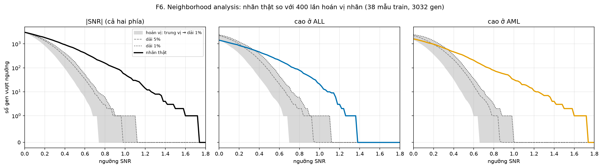
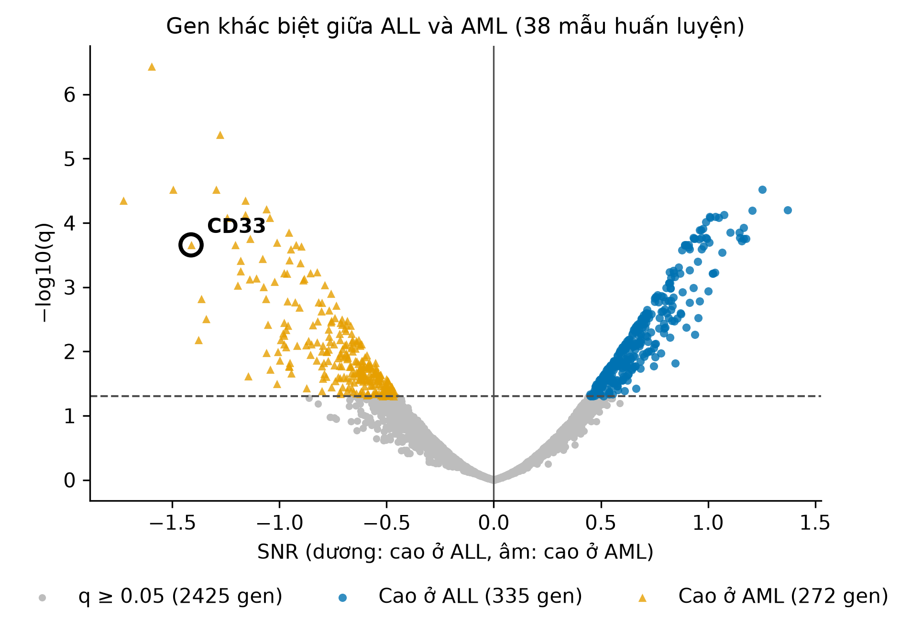
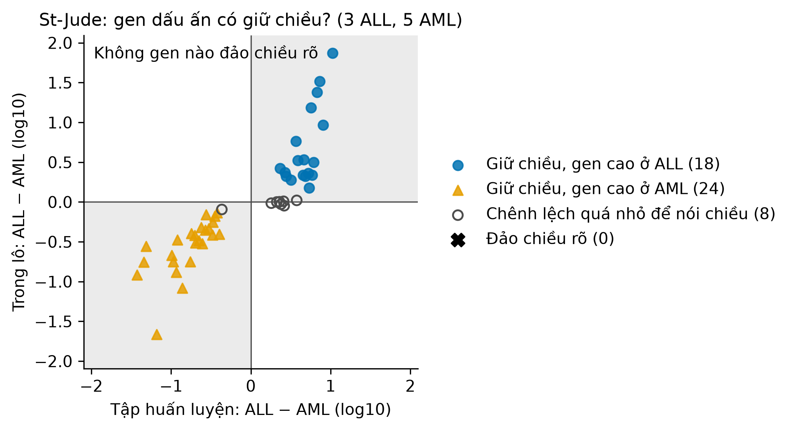
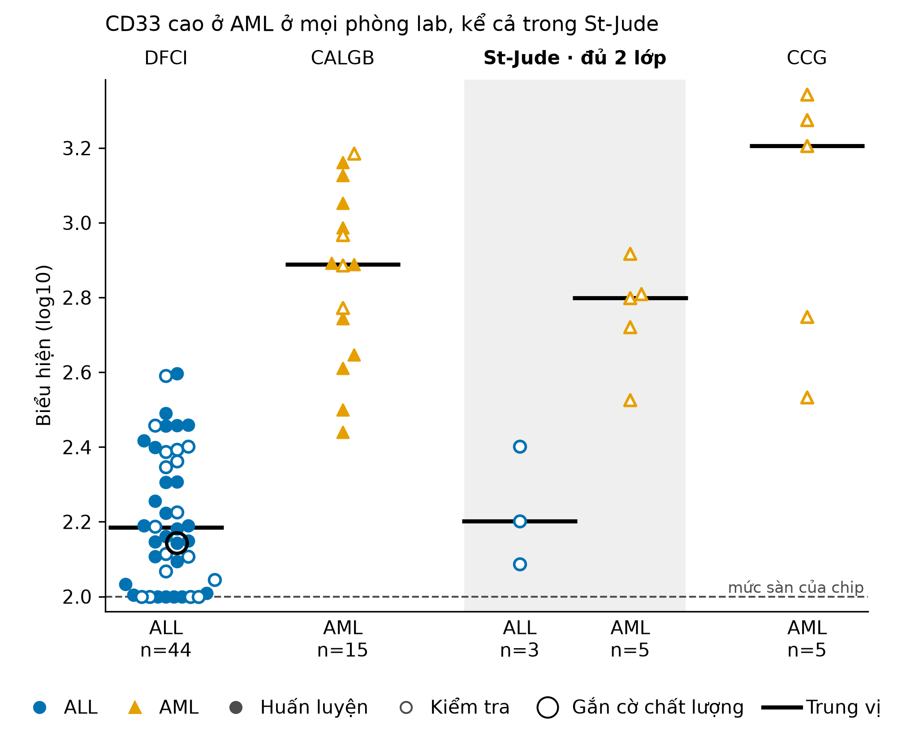
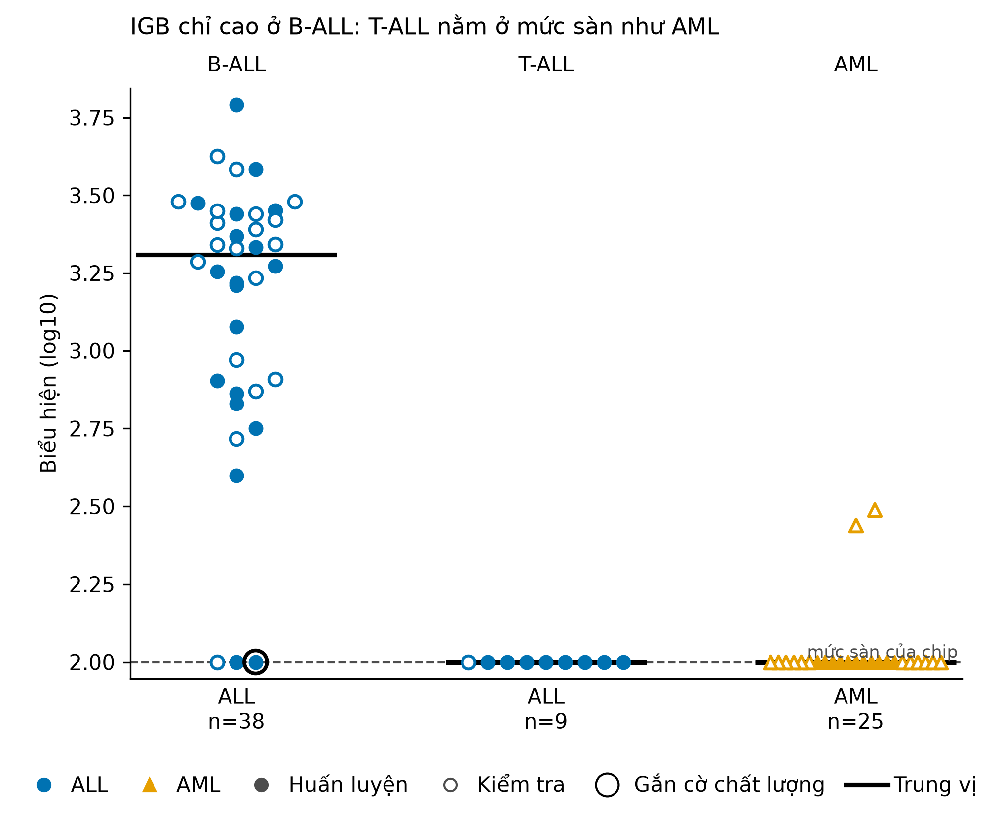
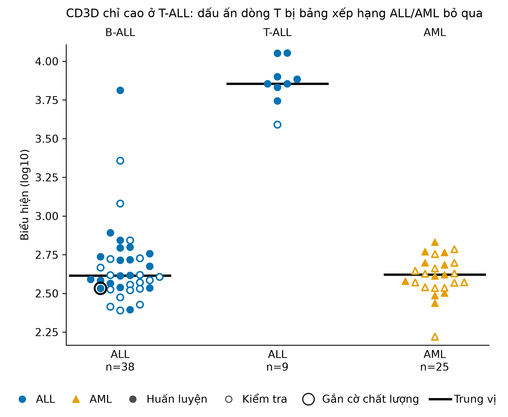
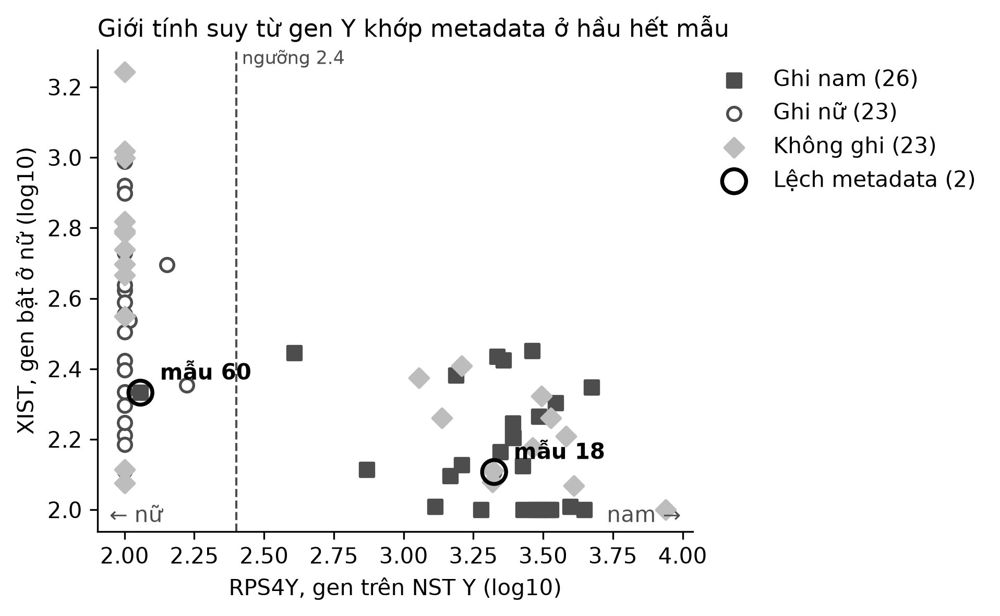
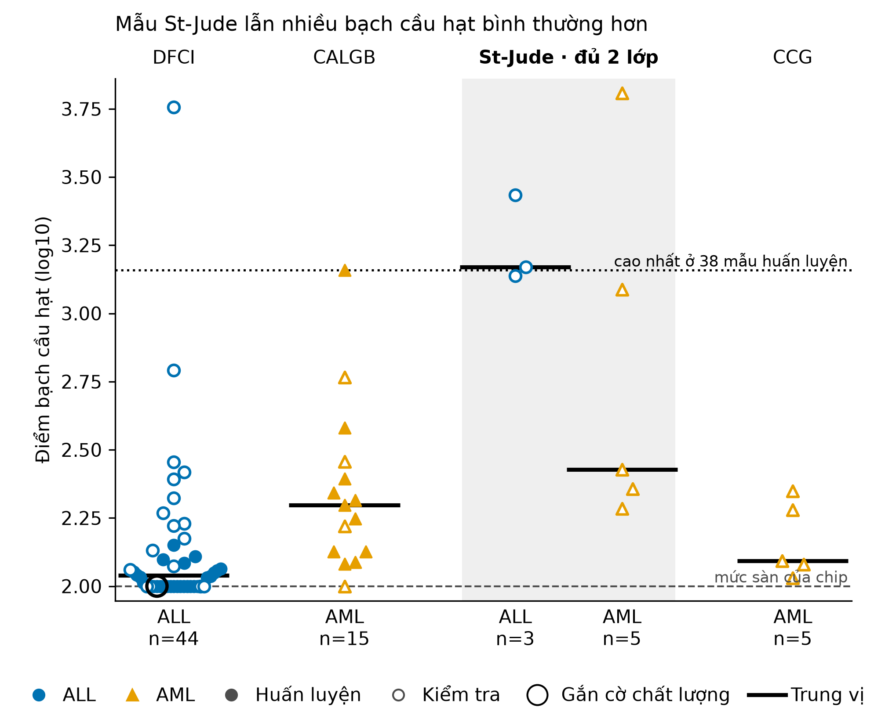

# Phân tích gen khác biệt và khám phá gen: sáu câu hỏi

Phụ trách: **Thành viên 4 (TV4)**, công việc 1.6 (giả thuyết H1) và 2.2 (màn hình Khám phá gen)
Mã và số liệu: `notebooks/04_de_genes.ipynb`, `src/gene_explorer.py`, `src/viz_gene.py`; quyết định ADR-052, ADR-053 trong `docs/decisions.md`. Hình nằm ở `results/figures/report/` (sinh lại bằng `python -m src.viz_gene`).

*Bản nháp 25/11, tổng hợp lại mục 3.3 và 4.x theo sáu câu hỏi. TV1 chọn cách ghép khi hoàn thiện báo cáo.*

## Dữ liệu và quy ước

- **Dữ liệu:** 72 bệnh nhân bạch cầu cấp, 38 mẫu huấn luyện (27 ALL, 11 AML) và 34 mẫu kiểm tra, từ 4 phòng lab (DFCI, CALGB, St-Jude, CCG). Biểu hiện gen lấy log10 sau khi chặn ngưỡng [100, 16 000], nên **mức sàn của chip là 2,0**. Gen biến thiên thấp được loại bằng bộ lọc học **chỉ trên 38 mẫu huấn luyện**; sau khi bỏ probe điều khiển còn 3032 gen.
- **Quy ước chống rò rỉ:** mọi xếp hạng gen, khoảng tham chiếu và ngưỡng đều tính trên 38 mẫu huấn luyện. Tập kiểm tra chỉ dùng để kiểm chứng.
- **Đại lượng chính:** SNR = (μ_ALL − μ_AML) / (σ_ALL + σ_AML) của Golub; SNR dương là gen cao ở ALL. **Gen dấu ấn** là 25 gen SNR dương lớn nhất và 25 gen SNR âm nhỏ nhất.

## Câu hỏi 1. Có thật nhiều gen khác biệt giữa ALL và AML không?

### Giả thuyết

- **H0:** nhãn ALL/AML không liên quan đến biểu hiện gen; gen nào trông khác biệt cũng chỉ do tình cờ.
- **H1:** có nhiều gen khác biệt hơn mức có thể xảy ra do ngẫu nhiên.

Cần kiểm định cẩn thận vì có 3032 gen mà chỉ có 38 mẫu: kiểm định từng gen ở mức 0,05 thì riêng do tình cờ đã có khoảng 152 gen "có ý nghĩa".

### Cách chứng minh

Dùng hai cách độc lập:
- **Neighborhood analysis** (như Golub): xáo nhãn 38 mẫu 400 lần (giữ 27/11). Mỗi lần xáo là một "thế giới H0"; đếm số gen vượt ngưỡng |SNR| ở thế giới đó rồi so với nhãn thật.
- **Welch t-test và hiệu chỉnh Benjamini–Hochberg (FDR):** tính q-value cho từng gen; làm lại với 100 lần xáo nhãn để biết mức ngẫu nhiên.

### Kết quả

*Hình 1. Số gen vượt từng ngưỡng |SNR| với nhãn thật so với dải 1% và 5% của 400 lần xáo nhãn.*

Đường của nhãn thật nằm cao hơn hẳn dải ngẫu nhiên; ở ngưỡng 0,5 nhãn thật có 640 gen, gấp hơn 3 lần dải 1%. Khi xáo nhãn, |SNR| lớn nhất chỉ khoảng 1,04; với nhãn thật có gen đạt 1,73 (CST3).

*Hình 2. Volcano plot trên 38 mẫu huấn luyện: trục ngang SNR, trục dọc −log10(q), đường đứt nét q = 0,05; CD33 được khoanh.*

Hình có dạng chữ V: gen càng chênh lệch nhiều (xa tâm) thì càng chắc chắn (càng cao). Hai cánh có màu là các gen có ý nghĩa, phía ALL và phía AML đều có.

| Chỉ số | Nhãn thật | Nhãn xáo (ngẫu nhiên) |
|---|---|---|
| Số gen có \|SNR\| > 0,5 | **640** | tối đa 178 (dải 1%) |
| Số lần xáo đạt mức nhãn thật | | 0/400 (p < 0,0025) |
| Số gen q < 0,05 | **607** (335 cao ở ALL, 272 cao ở AML) | trung vị 0, nhiều nhất 3 |
| \|SNR\| lớn nhất | 1,73 | khoảng 1,04 |

### Kết luận

**Bác bỏ H0, dữ liệu ủng hộ mạnh H1.** Hai cách độc lập cho cùng kết quả: thế giới thật không giống bất kỳ thế giới ngẫu nhiên nào. Khác biệt ALL/AML lan ra hàng trăm gen, nên dùng biểu hiện gen để phân biệt hai bệnh là có cơ sở.

## Câu hỏi 2. Khác biệt đó do bệnh hay do phòng lab?

### Giả thuyết

Trong tập huấn luyện **mọi ALL đến từ DFCI, mọi AML đến từ CALGB** (χ² = 33,3; p = 7,9·10⁻⁹). Vì vậy 607 gen ở câu hỏi 1 cũng có thể chỉ là gen khác nhau giữa hai phòng lab.

- **H0:** khác biệt chỉ do phòng lab. Khi đó, trong một phòng lab có cả hai bệnh, chiều ALL − AML của các gen dấu ấn sẽ lộn xộn, khoảng một nửa cùng chiều với tập huấn luyện.
- **H1:** khác biệt chủ yếu do bệnh. Khi đó chiều khác biệt vẫn giữ nguyên trong cùng một phòng lab.

### Cách chứng minh

St-Jude là nơi duy nhất gửi **cả hai bệnh** (3 ALL, 5 AML, đều thuộc tập kiểm tra): cùng phòng lab, chỉ khác bệnh.
- Với 50 gen dấu ấn chọn trên tập huấn luyện, so chênh lệch ALL − AML trên tập huấn luyện với chênh lệch trong St-Jude.
- Chênh lệch dưới 0,1 log10 (khoảng 1,26 lần) xếp là "quá nhỏ để nói chiều", không tính là giữ hay đảo.
- **Kiểm định hoán vị:** duyệt đủ 56 cách xếp 3 nhãn ALL vào 8 mẫu St-Jude, đếm bao nhiêu cách cho số gen cùng chiều từ mức quan sát trở lên.

### Kết quả

*Hình 3. Mỗi chấm là một gen dấu ấn: trục ngang là chênh lệch ALL − AML trên tập huấn luyện, trục dọc là chênh lệch trong St-Jude. Vùng nền xám là cùng chiều.*

Gần như mọi chấm rơi vào hai góc phần tư cùng chiều; không có chữ X đen (đảo chiều rõ). Các chấm rỗng xám nằm sát trục ngang là những gen gần mức sàn ở cả hai bệnh.

| Tiêu chí | Kết quả |
|---|---|
| Cùng dấu với tập huấn luyện | **46/50** gen |
| Chênh lệch ≥ 0,1 log10 và cùng chiều | **42** gen |
| Chênh lệch ≥ 0,1 log10 và đảo chiều | **0** gen |
| Chênh lệch < 0,1 log10 (quá nhỏ) | 8 gen, tối đa 0,094 |
| Kiểm định hoán vị | **p = 2/56 ≈ 0,036** |

Bốn gen ngược dấu (IRF2, RB1, TCF12, M77142_at) chỉ chênh 0,00–0,05 log10, sát mức sàn, nên không phải đảo chiều thật. Giữa 8 gen "quá nhỏ" (tối đa 0,094) và 42 gen giữ chiều (từ 0,135) có một khoảng trống tự nhiên, nên đặt ngưỡng ở đâu trong khoảng 0,1–0,13 cũng ra cùng kết quả.

### Kết luận

**Khác biệt ALL/AML chủ yếu do bệnh, không chỉ do phòng lab.** Trong cùng một lab, không gen dấu ấn nào đảo chiều rõ. Vì St-Jude chỉ có 8 mẫu, p nhỏ nhất có thể đạt là 1/56 ≈ 0,018, nên đây là bằng chứng ở mức vừa phải: làm yếu đi chứ chưa loại trừ hoàn toàn ảnh hưởng của phòng lab.

Một ví dụ cho thấy phòng lab vẫn ảnh hưởng tới **độ lớn** của khác biệt (câu hỏi 6): IL-8 (hạng 14, cao ở AML) khác nhau theo phòng lab ngay trong cùng một bệnh. AML của CALGB, nơi cung cấp toàn bộ AML huấn luyện, có IL-8 cao hơn AML của St-Jude khoảng 1 log10, nên chênh lệch ALL/AML của IL-8 trên tập huấn luyện bị phóng đại. Chiều khác biệt vẫn đúng: trong St-Jude, AML (2,66) vẫn cao hơn ALL (2,00).

## Câu hỏi 3. Gen tìm được có khớp với kiến thức y khoa không?

### Giả thuyết

Nếu phương pháp đúng, các gen đứng đầu bảng phải trùng với dấu ấn đã biết trong y văn và với danh sách 50 gen của Golub. Một dấu ấn lâm sàng như **CD33** (dấu ấn bề mặt dùng trên flow cytometry để nhận diện dòng tủy) phải nổi lên rõ và vững.

### Cách chứng minh

- So top gen với dấu ấn đã biết và với 50 gen trong Figure 3 của bài báo.
- Đối chiếu với **dấu ấn xác định dòng tế bào theo chuẩn quốc tế** (phân loại WHO 2022, tiêu chí EGIL): tra hạng của từng dấu ấn trong bảng 3032 gen. Theo chuẩn này, chẩn đoán dựa vào miễn dịch kiểu hình (flow cytometry) để xác định tế bào thuộc dòng tủy (AML), dòng B (B-ALL) hay dòng T (T-ALL).
- Với CD33: xem biểu hiện theo lớp và phòng lab; tỉ lệ mẫu chip ghi nhận "có mặt" (call P) theo từng lớp; chiều khác biệt qua 7 cách so sánh (toàn bộ 72 mẫu, bỏ mẫu lỗi QC, chỉ B-ALL, chỉ T-ALL, chỉ tủy xương, trong St-Jude).

### Kết quả

| Phía | Gen đứng đầu (hạng) |
|---|---|
| Cao ở AML | CST3 (1), Zyxin (2), LTC4S (3), **CD33 (4)** |
| Cao ở ALL | c-myb (6), TCF3/E2A (11), IGB (18) |

- Trong 50 gen của Golub, 39 gen xác định được probe; **22/39 trùng** với top 25 mỗi phía của nhóm, 17 gen còn lại vẫn nằm trong 8% gen đầu.
- Chỉ dùng **một gen** với ngưỡng ở trung điểm hai trung bình đã phân đúng 92–95% mẫu huấn luyện (CST3, Zyxin sai 2/38; CD33 sai 3/38).

**Đối chiếu với dấu ấn dòng tế bào theo WHO/EGIL:**

| Dòng tế bào | Dấu ấn theo chuẩn | Hạng trong dữ liệu (trên 3032 gen) |
|---|---|---|
| Tủy (AML) | CD33, lysozyme, **MPO** (dấu ấn quyết định), CD13 | 4, 47, 75, 93: đều trong top 100 |
| B (B-ALL) | CD79B (IGB), CD79A (MB-1), CD22; **CD19** (dấu ấn quyết định) | 18, 42, 68: đều trong top 70; CD19 không qua bộ lọc gen trên tập huấn luyện nên không có trong bảng |
| Tế bào non lympho | TdT | 61 |
| T (T-ALL) | CD3 (CD3G, CD3Z) | 457, 486: xếp thấp |
| Tế bào non chung | CD34, HLA-DR | 2680, 354: không phân biệt |

Dấu ấn dòng tủy và dòng B đều nằm trong nhóm đầu bảng: dữ liệu tự tìm lại bộ dấu ấn mà lâm sàng dùng. Dấu ấn dòng T xếp thấp vì CD3 chỉ cao ở T-ALL (9/47 mẫu ALL), còn B-ALL và AML đều ở mức sàn; bảng xếp hạng chỉ so ALL với AML nên không thấy được dòng T. CD34 và HLA-DR là dấu ấn của tế bào non, có ở cả hai bệnh, nên xếp thấp là đúng.

*Hình 4. Biểu hiện CD33 theo lớp và phòng lab. Chấm đặc: huấn luyện; chấm rỗng: kiểm tra; vạch đen: trung vị; nét đứt: mức sàn của chip; nền xám: St-Jude, nơi duy nhất có đủ hai lớp.*

AML (tam giác cam) cao hơn ALL (chấm xanh) ở mọi phòng lab, kể cả trong St-Jude (chênh 0,53 log10, khoảng 3,4 lần). Nhiều mẫu ALL nằm đúng mức sàn: chip không đo được CD33 ở các mẫu này.

| Kiểm tra CD33 | Kết quả |
|---|---|
| Tỉ lệ mẫu "có mặt" | 92% mẫu AML, 19% mẫu ALL: kiểu **bật/tắt** |
| Giữ chiều qua các cách so sánh | **6/6** phép so sánh đủ mẫu, chênh 0,53–0,69 log10 |

### Kết luận

**Dữ liệu tự tìm lại đúng dấu ấn lâm sàng đã biết**, và CD33 vững qua mọi cách so sánh. Các dấu ấn dòng tủy và dòng B theo chuẩn WHO/EGIL đều nằm trong nhóm đầu bảng; dấu ấn dòng T bị chìm, báo trước vấn đề nhóm con ở câu hỏi 4. Lưu ý chuẩn lâm sàng đo protein bằng flow cytometry, còn dữ liệu này đo mRNA, nên đây là đối chiếu chứ không phải kiểm chứng. Đây là "chứng dương": phương pháp đo đúng điều y học đã biết, nên các phát hiện mới ở câu hỏi 4–6 đáng tin hơn. Với gen kiểu bật/tắt như CD33, so sánh định tính (có hay không) đáng tin hơn con số "chênh 4 lần", vì ở ALL chip phần lớn không đo được.

## Câu hỏi 4. Gen "dấu ấn ALL" có đúng cho mọi bệnh nhân ALL không?

### Giả thuyết

Nhóm ALL gồm hai bệnh con: 38 B-ALL (tế bào B) và 9 T-ALL (tế bào T).
- **Giả thuyết:** một gen "cao ở ALL" trên bảng xếp hạng thì cao ở cả B-ALL lẫn T-ALL.
- **Giả thuyết phụ:** nếu có gen chỉ đúng với B-ALL, gen đó sẽ làm mô hình Golub kém chắc chắn khi gặp bệnh nhân T-ALL.

### Cách chứng minh

- Với 50 gen dấu ấn, tính riêng B-ALL − AML và T-ALL − AML trên 72 mẫu. Một nhóm con "giữ" khi cùng chiều với tập huấn luyện và chênh từ 0,1 log10 (hàm `subtype_check`).
- Với mô hình Golub weighted voting 50 gen của TV1 (tái lập đúng độ tin cậy PS đã công bố trong nhóm): bỏ các gen chỉ đúng với B-ALL, chạy lại kiểm tra chéo bỏ-một-ra (LOOCV) trên 38 mẫu, so PS từng mẫu trước và sau.

### Kết quả

*Hình 5. Biểu hiện IGB theo nhóm con: B-ALL cao, còn cả 9 mẫu T-ALL nằm ở mức sàn giống AML.*

IGB đứng hạng 18 và trên bảng xếp hạng trông như một gen dấu ấn ALL tốt. Tách theo nhóm con mới thấy nó chỉ cao ở B-ALL. IGB là một phần của thụ thể tế bào B, nên tế bào T không có.

| Gen (hạng) | B-ALL − AML | T-ALL − AML | Tỉ lệ T-ALL ở mức sàn |
|---|---|---|---|
| IGB (18) | +1,11 | −0,04 | 100% |
| IRF2 (19) | +0,26 | −0,03 | 67% |
| TCL1 (23) | +1,43 | −0,03 | 100% |
| CD24 (43) | +1,03 | −0,07 | 89% |

46/50 gen dấu ấn đúng cho cả hai nhóm con; **4 gen chỉ đúng với B-ALL**. Mô hình Golub của TV1 dùng toàn bộ gen (không qua bộ lọc của bảng xếp hạng) nên chọn 4 gen này cùng CD19, cũng là gen chỉ đúng với B-ALL (B-ALL − AML +0,34, T-ALL − AML +0,04). Với bệnh nhân T-ALL, cả 5 gen đều bỏ phiếu AML.

| LOOCV, PS trung vị | Đủ 50 gen | Bỏ 5 gen chỉ đúng với B-ALL |
|---|---|---|
| T-ALL (8 mẫu) | 0,61 | **0,70**, cả 8/8 mẫu tăng (Wilcoxon p = 0,0078) |
| B-ALL (19 mẫu) | 0,80 | 0,79 |
| AML (11 mẫu) | 0,68 | 0,67 |
| Số mẫu đoán đúng | 36/38 | 35/38 (mẫu AML 32, PS 0,307, thành "không chắc chắn") |

### Kết luận

**Giả thuyết bị bác bỏ: 4/25 gen "dấu ấn ALL" thực ra chỉ là gen của B-ALL** (5 gen trong mô hình Golub, tính cả CD19). Chính các gen này làm mô hình kém chắc chắn với bệnh nhân T-ALL; bỏ chúng thì độ tin cậy với T-ALL tăng rõ. Vì có đánh đổi (một mẫu AML sát ngưỡng thành không chắc chắn), đây là đề xuất cải tiến cho mô hình ở chương 5, không phải thay đổi bắt buộc. Phát hiện này không thấy được nếu chỉ nhìn bảng xếp hạng.

### Bổ sung: tín hiệu phân biệt T-ALL với B-ALL

Mục 3.2 (phân cụm không giám sát) kết luận không phương pháp nào tách được T-ALL thành cụm riêng. Câu hỏi đặt ra: tín hiệu phân biệt T-ALL với B-ALL không tồn tại, hay có nhưng bị lấn át? Để trả lời, nhóm so 9 T-ALL với 38 B-ALL bằng SNR trên 3032 gen (dương là cao ở T-ALL), rồi xáo nhãn T/B 400 lần như neighborhood analysis ở câu hỏi 1 (hàm `subtype_contrast`, dùng cả 47 mẫu ALL, chỉ để mô tả).

| Ngưỡng | Nhãn thật | Xáo nhãn (dải 1%) | Xáo nhãn (nhiều nhất) |
|---|---|---|---|
| \|SNR\| > 0,5 | 415 | 179 | 194 |
| \|SNR\| > 1,0 | **72** | 1 | 2 |
| \|SNR\| > 1,5 | **23** | 0 | 0 |

Các gen đứng đầu đúng là dấu ấn dòng tế bào theo chuẩn WHO/EGIL:

| Phía | Gen đứng đầu (SNR) |
|---|---|
| Cao ở T-ALL | CD3 chuỗi delta (2,89), LCK (2,07), TCF7 (1,94), CD7 (1,79), CD3G (1,73), CD47 (1,70), CD3 chuỗi epsilon (1,69) |
| Cao ở B-ALL | IGB (−2,61), TCL1 (−2,10), CD9 (−1,86), HLA-DR (−1,84), CD24 (−1,78) |

*Hình 6. Biểu hiện CD3 chuỗi delta (CD3D) theo nhóm con: 9 mẫu T-ALL cao hẳn (trung bình 3,86), còn B-ALL (2,68) và AML (2,61) ngang nhau.*

CD3 là dấu ấn quyết định dòng T. Nó tách T-ALL rất rõ, nhưng trong bảng xếp hạng ALL/AML lại nằm ngoài top 400 (CD3D hạng 423, CD3G 457, CD3 chuỗi epsilon 2022), vì chỉ cao ở 9/47 mẫu ALL. Phía B-ALL đứng đầu chính là các gen "chỉ đúng với B-ALL" ở trên (IGB, TCL1, CD24).

**Kết luận bổ sung:** tín hiệu phân biệt T-ALL với B-ALL có thật và mạnh (72 gen so với tối đa 2 gen khi xáo nhãn). Phân cụm không tách được T-ALL (mục 3.2) **không phải vì thiếu tín hiệu mà vì nhóm quá nhỏ**: 9 mẫu với vài chục gen đặc trưng bị lấn át khi phân cụm trên hàng nghìn gen.

## Câu hỏi 5. Chất lượng dữ liệu có đáng tin không?

### Giả thuyết

Ba khía cạnh của chất lượng dữ liệu, mỗi khía cạnh một giả thuyết:
- **a. Metadata:** giới tính ghi trong metadata là đúng.
- **b. Độ tinh khiết mẫu:** mẫu bạch cầu cấp gồm chủ yếu tế bào ung thư; mẫu kiểm tra tinh khiết tương tự mẫu huấn luyện.
- **c. Cảnh báo lô mới:** cách cảnh báo "mẫu có gen dấu ấn nằm ngoài khoảng tham chiếu" phát hiện đúng mẫu bất thường.

### Cách chứng minh

- **a.** Gen RPS4Y nằm trên nhiễm sắc thể Y, nên chỉ có ở nam. So giới tính suy từ gen này với giới tính đã ghi (hàm `sex_check`). Trên các mẫu có ghi (không tính 2 mẫu lệch), nữ cao nhất 2,22 và nam thấp nhất 2,61, nên đặt ngưỡng 2,4 ở giữa.
- **b.** Khi tìm gen khác nhau theo phòng lab trong cùng một bệnh (hàm `lab_effect`), gen khác nhiều nhất giữa B-ALL của DFCI và St-Jude là **DEFA1** (chênh 1,73 log10), một gen của bạch cầu trung tính bình thường chứ không phải của tế bào ung thư. Từ đó tính **điểm bạch cầu hạt** cho từng mẫu: trung bình log10 của 5 gen hạt (DEFA1, DEFA4, LTF, ELANE, LCN2). Ngưỡng là điểm cao nhất ở 38 mẫu huấn luyện, không dùng nhãn (hàm `purity_check`).
- **c.** Đo **mức nền** của cảnh báo: bỏ từng mẫu huấn luyện ra, so với 37 mẫu còn lại, xem mẫu bình thường bị gắn cờ bao nhiêu lần (hàm `batch_anomalies`).

### Kết quả

**a. Giới tính**

*Hình 7. Giới tính theo gen Y (trục ngang) và XIST, gen bật ở nữ (trục dọc). Nét đứt là ngưỡng 2,4; hai mẫu lệch metadata được khoanh.*

Hai cụm tách rõ theo trục ngang: bên trái là nữ, bên phải là nam. XIST chồng lấn giữa hai giới nên chỉ để tham khảo.

| Giới tính | Kết quả |
|---|---|
| Khớp với metadata | **47/49** mẫu có ghi |
| Lệch metadata | Mẫu 18: ghi nữ nhưng gen Y = 3,32, nhiều khả năng ghi nhầm. Mẫu 60 (AML): ghi nam nhưng gen Y ở mức sàn, có thể ghi nhầm hoặc mất nhiễm sắc thể Y (bất thường gặp ở bệnh bạch cầu) |
| Không ghi giới tính | 23 mẫu (cả 15 mẫu CALGB), suy ra được 12 nữ, 11 nam |

**b. Độ tinh khiết mẫu**

*Hình 8. Điểm bạch cầu hạt theo lớp và phòng lab. Đường chấm là mức cao nhất ở 38 mẫu huấn luyện (3,16).*

Đa số mẫu nằm gần mức sàn, tức là tinh khiết. **Cả 3 mẫu B-ALL của St-Jude** nằm cao vượt hẳn (trung vị 3,17, so với 2,05 của B-ALL DFCI), cùng một mẫu AML của St-Jude và một mẫu DFCI.

- **4 mẫu kiểm tra lẫn nhiều bạch cầu hạt hơn mọi mẫu huấn luyện:** 60, 59, 56 (St-Jude) và 43 (DFCI).
- Không mẫu ALL huấn luyện nào có điểm trên 2,7, trong khi 5/20 mẫu ALL kiểm tra vượt mức đó.
- Gen dấu ấn AML **ELA2** (elastase bạch cầu trung tính, hạng 8) tương quan 0,91 với điểm này trong nhóm ALL. ELA2 vẫn là dấu ấn AML thật: bệnh nhân AML có ELA2 cao (trung vị 3,24, không mẫu nào ở mức sàn), còn ALL tinh khiết tối đa chỉ 2,54. Nhưng các mẫu ALL kém tinh khiết có ELA2 cao ngang hoặc hơn AML: mẫu 59 là 3,94, mẫu 43 là 3,85, mẫu 55 là 3,32.
- Đối chiếu độ tin cậy PS của mô hình Golub trên mẫu ALL kiểm tra: tương quan −0,15 (p = 0,54), chưa thấy ảnh hưởng rõ.

**c. Cảnh báo lô mới**

| Lô mới | Mẫu có gen ngoài khoảng | Mẫu đáng chú ý (> 1,85 SD) |
|---|---|---|
| **Mẫu huấn luyện bình thường (mức nền)** | **18/38 (47%)** | 5% theo định nghĩa ngưỡng |
| CALGB (4) | 4 | 0 |
| CCG (5) | 3 | 0 |
| DFCI (17) | 6 | 1 (mẫu 42) |
| St-Jude (8) | 6 | 0 |

Cảnh báo đơn giản gắn cờ gần một nửa số mẫu bình thường, vì xét 50 gen cùng lúc thì việc vài gen vượt khoảng là chuyện thường. Vì vậy kết quả cũ "CCG 3/5 mẫu bất thường" thực ra bằng mức ngẫu nhiên. Sau khi đặt ngưỡng theo mức nền (1,85 SD, mức mà 95% mẫu huấn luyện không vượt), chỉ còn mẫu 42: gen LTC4S nằm đúng mức sàn, lệch theo hướng giống ALL hơn, nên cần xem lại chứ không phải mẫu sai.

### Kết luận

- **a. Metadata giới tính phần lớn đúng nhưng không hoàn hảo:** biểu hiện gen phát hiện 2 mẫu cần kiểm tra lại và bổ sung được 23 mẫu thiếu.
- **b. Giả thuyết b bị bác bỏ: một số mẫu kiểm tra, chủ yếu của St-Jude, kém tinh khiết**, lẫn nhiều tế bào tủy bình thường hơn mọi mẫu huấn luyện. **Cảnh báo:** ELA2 là dấu ấn AML thật, nhưng ELA2 cao chỉ cho biết mẫu có nhiều tế bào dòng bạch cầu hạt; đó có thể là tế bào ung thư AML, cũng có thể là tế bào tủy bình thường lẫn vào mẫu ALL. Vì vậy, với mẫu kém tinh khiết, **ELA2 cao không đủ để kết luận AML**; cần xem cùng các gen không thuộc bạch cầu hạt, như gen dòng lympho (IGB, CD79A) hoặc CD33. Mô hình Golub vẫn đoán đúng là ALL cả 4 mẫu ALL có ELA2 cao (43, 55, 56, 59; độ tin cậy 0,56–0,73) nhờ các gen khác này, và với cỡ mẫu hiện tại chưa thấy độ tin cậy của mô hình giảm rõ rệt.
- **c. Giả thuyết c bị bác bỏ ở dạng ban đầu:** cảnh báo chưa có mức nền báo động nhầm 47%. Phải đo xem cảnh báo nhầm bao nhiêu trước khi tin vào nó; sau khi thêm mức nền, cảnh báo mới có ý nghĩa.

Trong cả ba trường hợp, công cụ chỉ cảnh báo để người dùng kiểm tra lại, không tự sửa dữ liệu. Đây là tinh thần quản trị dữ liệu: dùng chính dữ liệu để kiểm tra dữ liệu.

## Câu hỏi 6. Danh sách gen dấu ấn có ổn định và độc lập không?

### Giả thuyết

- **a. Ổn định:** nếu lấy một bộ 38 bệnh nhân huấn luyện khác (cùng tỉ lệ ALL/AML), ta sẽ chọn lại gần như cùng 50 gen dấu ấn.
- **b. Độc lập:** 50 gen dấu ấn mang 50 tín hiệu riêng biệt.

### Cách chứng minh

- **a. Bootstrap** (hàm `marker_stability`): lấy lại mẫu có hoàn lại 100 lần trong từng lớp (giữ 27 ALL, 11 AML), mỗi lần tính lại SNR và chọn lại 25 + 25 gen. Đo tỉ lệ mỗi gen dấu ấn gốc được chọn lại, và độ trùng (Jaccard) giữa danh sách mới với danh sách gốc.
- **b. Tương quan gen–gen** (hàm `marker_correlation`): tính ma trận tương quan giữa 50 gen, so khi xét cả hai lớp (38 mẫu huấn luyện) với khi xét **trong cùng một lớp** (47 ALL hoặc 25 AML). Số tín hiệu độc lập được ước tính từ trị riêng của ma trận tương quan (participation ratio). Các nhóm gen cùng biến động được tìm bằng phân cụm phân cấp (khoảng cách 1 − r, liên kết average, cắt ở 0,5). Hình F05 của mục 3.2 đã phân cụm 50 gen này trên cả 72 mẫu, nơi tương quan chủ yếu do bệnh tạo ra; ở đây xét tiếp trong cùng một bệnh để thấy phần còn lại.

### Kết quả

**a. Độ ổn định**

| Chỉ số | Kết quả |
|---|---|
| Độ trùng trung bình với danh sách gốc (Jaccard) | **0,36** (thấp nhất 0,15) |
| Gen được chọn lại ở ≥ 80% số lần | **5/50**: Zyxin (99%), CST3 (97%), c-myb (91%), LTC4S (85%), TCF3 (83%) |
| Gen được chọn lại ở < 30% số lần | 8/50, có hạng 31–58 |
| CD33, IGB | 75%, 67% |
| Gen ngoài danh sách hay được chọn | CD22 (42%), PFC (39%), PPBP (38%), MCM3 (37%), Op18 (34%) |

Các gen đầu bảng rất ổn định. Càng xuống dưới, danh sách càng thay đổi theo mẫu: gen ở cuối danh sách dễ bị gen khác (như CD22, một dấu ấn dòng B) thay chỗ.

**b. Tương quan và tín hiệu độc lập**

| Xét trên | Tương quan trung bình \|r\| | Thành phần chính đầu tiên | Số tín hiệu độc lập |
|---|---|---|---|
| 38 mẫu huấn luyện (cả hai lớp) | 0,53 | 54% | **khoảng 3** |
| Chỉ trong ALL (47 mẫu) | 0,21 | 22% | khoảng 11 |
| Chỉ trong AML (25 mẫu) | 0,24 | 22% | khoảng 10 |

Khi xét cả hai lớp, 50 gen gần như cùng đi theo một yếu tố là bệnh (gen cùng phía tương quan +0,61, khác phía −0,45). Trong cùng một lớp, tương quan giảm mạnh, nhưng vẫn còn các nhóm gen cùng biến động:

| Trong lớp | Nhóm gen (tương quan trong nhóm) | Đi theo yếu tố nào |
|---|---|---|
| ALL | IGB, TCL1, CD79A (MB-1), CD24, chuỗi nhẹ Ig lambda, TdT (r = 0,68) | **Nhóm con:** cao ở B-ALL (3,38), thấp ở T-ALL (2,30); câu hỏi 4 |
| ALL | c-myb, TCF3, RbAp48, IRF2, RB1, TOP2B, TCF12 và 4 gen khác (r = 0,60) | Chưa rõ |
| AML | Adipsin, ELA2, azurocidin, GST vi thể (r = 0,62) | **Độ tinh khiết:** tương quan 0,74 với điểm bạch cầu hạt; câu hỏi 5b |
| ALL và AML | IL-8 (hai probe), ADM, PTX3 (r = 0,67–0,72) | **Phòng lab** (xem dưới) |
| AML | CST3, Zyxin, cystatin A, LYN, pleckstrin và 2 gen khác (r = 0,56) | Chưa rõ |
| AML | LTC4S, LEPR, FAH, CHRNA7, HOXA9 (r = 0,59) | Chưa rõ |

**Nhóm IL-8 và phòng lab:**

| Trung bình nhóm IL-8 | CALGB | CCG | St-Jude | DFCI |
|---|---|---|---|---|
| AML | 3,65 | 2,96 | 2,66 | |
| ALL | | | 2,00 | 2,34 |

- Trong B-ALL, IL-8 khác nhau giữa DFCI và St-Jude có ý nghĩa sau hiệu chỉnh FDR (q = 0,002).
- Trong AML, chênh giữa các lab tới khoảng 1 log10 (p = 0,02 khi xét riêng nhóm IL-8), nhưng không còn ý nghĩa khi hiệu chỉnh trên toàn bộ 3032 gen (q ≈ 0,19).

### Kết luận

- **a. Giả thuyết a chỉ đúng một phần:** vài gen đầu bảng (Zyxin, CST3, c-myb, LTC4S, TCF3) rất ổn định, nhưng thành phần chính xác của danh sách 50 gen thay đổi nhiều theo mẫu (Jaccard trung bình 0,36). Vì vậy không nên diễn giải quá mức thứ hạng của từng gen ở cuối danh sách.
- **b. Giả thuyết b bị bác bỏ:** khi xét cả hai lớp, 50 gen chỉ mang khoảng 3 tín hiệu độc lập. Điều này giải thích luôn kết quả a: các gen tương quan mạnh có thể thay thế nhau, nên danh sách đổi thành phần mà kết luận về khác biệt ALL/AML không đổi.
- **Hệ quả cho mô hình Golub (chương 5, TV1):** 50 phiếu không phải 50 ý kiến độc lập; nhóm gen tương quan bỏ phiếu cùng nhau. Ví dụ nhóm gen tế bào B cùng bầu AML cho bệnh nhân T-ALL, nên vấn đề ở câu hỏi 4 bị khuếch đại.
- **Trong cùng một bệnh**, các nhóm gen còn lại đi theo đúng những yếu tố đã gặp ở các câu trước: nhóm con (tế bào B), độ tinh khiết (hạt bạch cầu) và phòng lab (IL-8). Tên chức năng của các nhóm "chưa rõ" cần chú giải gen của TV5.

**Giới hạn:** ngưỡng cắt nhóm (0,5) là chọn tay; tương quan trong AML chỉ dựa trên 25 mẫu; phân tích chỉ mô tả.

## Tổng kết

| # | Câu hỏi | Kết luận |
|---|---|---|
| 1 | Có nhiều gen khác biệt thật không? | Có: 607 gen so với 0 khi xáo nhãn. Bác bỏ H0 |
| 2 | Do bệnh hay do phòng lab? | Chủ yếu do bệnh: trong St-Jude 42 giữ chiều, 0 đảo chiều (p = 0,036), bằng chứng vừa phải |
| 3 | Khớp kiến thức y khoa không? | Có: tìm lại CST3, Zyxin, CD33; trùng 22/39 gen của Golub; dấu ấn dòng tủy và dòng B theo WHO/EGIL đều trong top 100 |
| 4 | Gen dấu ấn ALL đúng cho mọi ALL không? | Không: 4/25 gen chỉ đúng với B-ALL (5 trong mô hình Golub), làm mô hình kém chắc chắn với T-ALL. Tín hiệu T/B có thật (72 gen so với tối đa 2 khi xáo nhãn), chỉ bị lấn át vì T-ALL ít mẫu |
| 5 | Chất lượng dữ liệu có đáng tin không? | Phần lớn: giới tính khớp 47/49; một số mẫu St-Jude kém tinh khiết nên không dùng ELA2 để kết luận ở các mẫu đó; cảnh báo lô mới cần mức nền mới dùng được |
| 6 | Danh sách gen dấu ấn có ổn định và độc lập không? | Chỉ vài gen đầu ổn định (Jaccard 0,36); 50 gen chỉ mang khoảng 3 tín hiệu độc lập, các nhóm gen trong cùng bệnh đi theo nhóm con, độ tinh khiết và phòng lab |

> **Một câu:** *gen thật sự phân biệt được ALL và AML, chủ yếu do bệnh chứ không do phòng lab; nhưng khi soi kỹ từng gen, nhóm phát hiện một phần gen dấu ấn ALL chỉ đúng với B-ALL, và chính chúng làm mô hình kém chắc chắn với bệnh nhân T-ALL.*

**Giới hạn chung:**
- Chỉ 8 mẫu St-Jude để tách bệnh khỏi phòng lab; chỉ 9 mẫu T-ALL.
- Các ngưỡng (giới tính 2,4; độ tinh khiết 3,16; mức nền 1,85 SD) lấy từ chính dữ liệu này, cần đặt lại với chip khác.
- Bộ lọc gen học trên 38 mẫu huấn luyện. Bản trước lọc trên cả 72 mẫu, có nhìn giá trị tập kiểm tra (không nhìn nhãn); đã sửa theo rà soát rò rỉ của TV2 (`docs/leakage_review.md` mục 3.5). Kết quả gần như không đổi so với bản cũ: 640 so với 685 gen |SNR| > 0,5, 607 so với 627 gen q < 0,05, 48/50 gen dấu ấn trùng (CD19 và thrombospondin không qua bộ lọc trên tập huấn luyện, thay bằng TdT và CD36).
- Đây là phân tích khám phá trên dữ liệu năm 1999, không phải công cụ chẩn đoán.

**Tài liệu tham khảo cho dấu ấn dòng tế bào:** phân loại WHO các khối u mô tạo máu và lympho, bản thứ 5 (2022); Bene M.C. và cộng sự, *Proposals for the immunological classification of acute leukemias* (EGIL), Leukemia, 1995.
